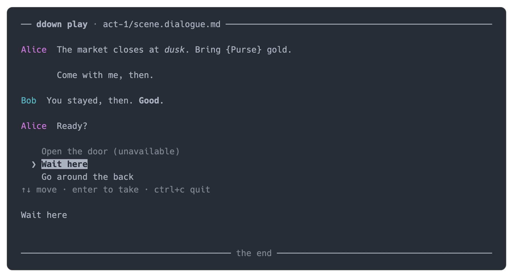
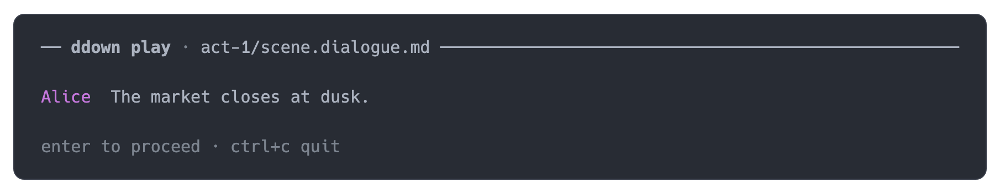
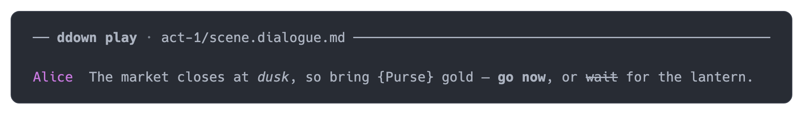
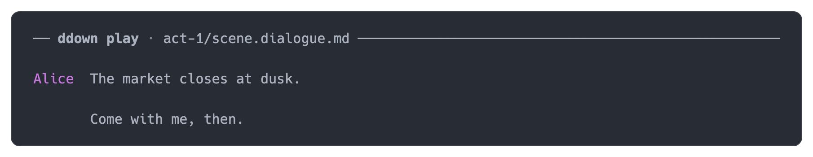
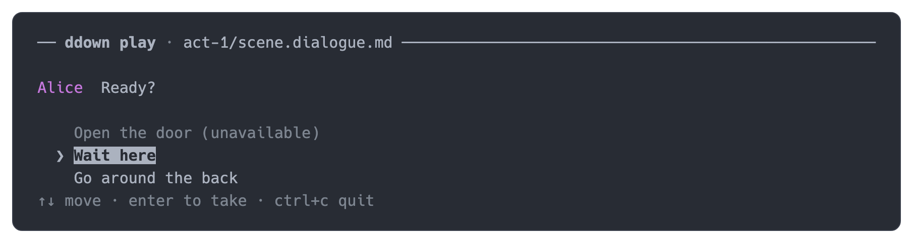
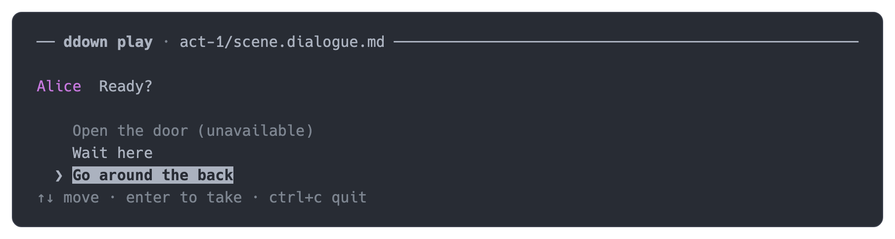
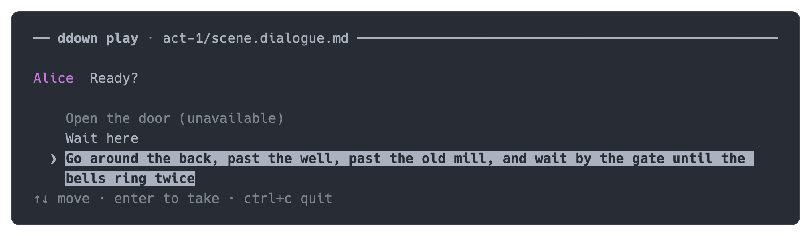
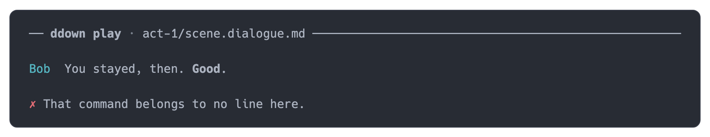
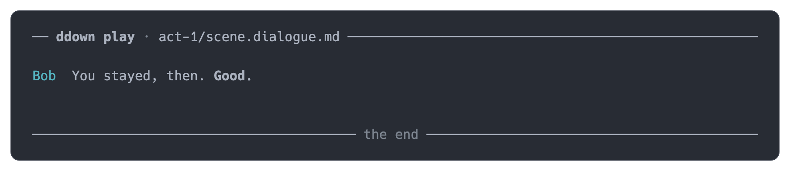
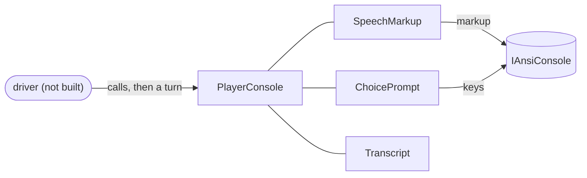

# Play CLI — Terminal Player

> [!NOTE]
> Status: **implemented** for the presentation: speech rendering, the choice menu, and the
> player's turns, in `DialogueDown.Play`. The `ddown play` command is **not built**, and
> neither is the driver that feeds the player from the [runner](../runtime/Runner.md) or the
> raw stdio REPL; the runtime note's
> [components and sequencing](../runtime/Dialogue%20Runtime%20Architecture.md#components-and-sequencing)
> table plans them.

## Table of contents

- [Goal and scope](#goal-and-scope)
- [Functionality checklist](#functionality-checklist)
- [Ubiquitous language](#ubiquitous-language)
- [The look](#the-look)
- [Interfaces and abstractions](#interfaces-and-abstractions)
- [Key design decisions](#key-design-decisions)
- [Error and boundary cases](#error-and-boundary-cases)
- [Integration](#integration)
- [Dependency survey](#dependency-survey)
- [Testability](#testability)
- [What this does not do](#what-this-does-not-do)

## Goal and scope

`ddown play` will let a reader play a compiled [playbook](../runtime/Playbook%20Format.md)
at the terminal: read a line, take a choice, follow the jump, reach an ending. This note
designs the half that decides how that **looks and reads** — the presentation — and
leaves the half that decides what happens next, the driver, unbuilt. It follows direction A
of the [Interactive Playthrough](../other/Interactive%20Playthrough.md) spike.

In scope:

- rendering a line's [speech](../runtime/Speech%20as%20Plain%20Text.md) — speaker,
  emphasis, links, images, queries — as terminal text;
- offering a menu whose unavailable options are shown but cannot be taken;
- reading the player's turns: advance, take, quit;
- the transcript those turns build, and its ending;
- all of it testable without a terminal.

Out of scope (the driver, not built): loading a playbook, stepping the runner, mapping
`Said`/`Continued`/`Offer`/`Refused`/`Ended` to the player and `Done`/`Choose` back;
the `ddown play` command; the raw stdio REPL; saves, history, and world answers.

## Functionality checklist

- [x] A line renders its speaker apart from the words; every speaker carries a color of
      its own; a continuation renders without repeating the speaker.
- [x] Italic, bold, and strikethrough render as such, and nest.
- [x] Text with markup characters renders literally: `Use [brackets]` shows the brackets.
- [x] A query with no answer renders as `{Key}` — the convention
      [`SpeechText.Of`](../runtime/Speech%20as%20Plain%20Text.md) sets.
- [x] A link renders its label; an image renders its alt text; commands and tags render
      nothing.
- [x] A menu shows every option; an unavailable one is dimmed and says so; the cursor
      never rests on it; the option under the cursor is inverted, so the choice reads
      without color.
- [x] A refusal renders as a red cross, apart from speech.
- [x] Long labels wrap under their own words, and a move redraws the menu in place.
- [x] Any key goes on (Escape is the one that does nothing); Enter on an option takes it;
      Ctrl+C quits, at either wait.
- [x] A wait hint appears where the player acts and is erased once answered; a menu keeps a
      dim key footer.
- [x] A turn is a value: advance, `Take(index)`, quit.
- [x] A non-interactive console is refused with a message that names the alternative.
- [x] The transcript reads in order and its ending is marked.

## Ubiquitous language

| Term | Meaning |
| --- | --- |
| **Player** | The person at the terminal. |
| **Transcript** | The lines, menus, notices, and ending the player has read, in order. |
| **Line** | One speaker's words. |
| **Continuation** | The same speaker going on after a command in the line. |
| **Menu** | The options offered together, and the wait for one to be taken. |
| **Option** | A menu entry: its label words, and whether it is available. |
| **Available** | Whether an option can be taken; its condition says so. |
| **Take** | The player's choice of an option, named by its position among those offered. |
| **Notice** | What the player must see that is not speech: a refusal, a hint. |
| **Turn** | The player's one interaction with a prompt: advance, take an option, or quit. |
| **Ending** | The marked end of the transcript. |

The menu words are the runtime's — *offer*, *option*, *available*, *take* — and the
architecture note fixes the rule this player must keep: a menu reports an unavailable
option rather than hiding it
([D8](../runtime/Dialogue%20Runtime%20Architecture.md#d8--a-menu-shows-unavailable-options)),
and [Offering a Choice](../runtime/Offering%20a%20Choice.md) holds the runner's menu protocol.
The player's own words are new: *transcript*, *line*, *continuation*, *notice*, *turn*,
*ending*. The transcript is the player's record of what the terminal showed — not the run's
history, which is a
[shell-side fold](../runtime/Dialogue%20Runtime%20Architecture.md#history-is-a-shell-side-fold).

## The look



Every speaker's name carries a color of its own, so two voices read apart at a glance;
the name is still what identifies them. The words are plain, and the writer's emphasis
arrives as itself. The menu cursor is the only moving thing; an unavailable option is dimmed
and marked. Nothing blinks and nothing asks twice: hints appear where the player acts — a
line under the last speech while it waits, a key footer inside a menu — and the transcript
scrolls in the terminal's own scrollback.

The captures come from a throw-away prototype rendering the real `SpeechFragment`s through
Spectre.Console — wireframes for the implementation, not screenshots of shipped code. They
show one dark theme's palette; the player emits the sixteen ANSI color names, so a
terminal's own palette decides how they read.

### Base cases

**A wait** — the hint sits where the action is and is erased the moment the key arrives:



**A line** — the speaker, the writer's emphasis, a query's placeholder, and a link's label:



**A continuation** — the same speaker after a command, aligned under the words:



**A menu** — every option in the offered order; *Open the door* failed its condition and
is shown unavailable; the cursor starts on the first option that can be taken:



**The same menu after one arrow key** — the cursor has skipped the unavailable option:



**A long option** — a label wider than the terminal wraps under its own words:



**A notice** — a refusal the player must read, marked apart from speech:



**The ending** — the transcript closes with a rule:



## Interfaces and abstractions

| Type | Responsibility | Collaborators |
| --- | --- | --- |
| `PlayerConsole` | What a driver calls: starts the transcript, appends lines, continuations, menus, and notices, ends it, and asks for the player's turn. Requires an interactive console. | `IAnsiConsole`, `SpeechMarkup`, `ChoicePrompt`, `TranscriptEntry` |
| `SpeechMarkup` | Renders speech fragments as Spectre markup: emphasis, escaping, queries, and what a link, an image, a command, and a tag contribute. | the playbook's fragment records |
| `ChoicePrompt` | Shows a menu, moves the cursor over available options only, and reports the taken index, or `null` when the player quits. | `IAnsiConsole`, `MenuOption` |
| `MenuOption` | One option as shown: its label words and whether it is available. | — |
| `PlayerTurn` | The player's turn as a value: `Advance`, `Take(index)`, or `Quit`. | `PlayerConsole` |
| `TranscriptEntry` | One thing the player read: a line, a continuation, a menu with the option taken (or with none, when the player quit), a notice, or the ending. | `PlayerConsole` |



```csharp
public sealed class PlayerConsole
{
    public PlayerConsole(IAnsiConsole console);          // refuses a non-interactive console
    public IReadOnlyList<TranscriptEntry> Transcript { get; }

    public void Start(string title);
    public void Say(string? speaker, ImmutableArray<SpeechFragment> words);
    public void Continue(ImmutableArray<SpeechFragment> words);
    public void Notice(string text);
    public void End();

    public Task<PlayerTurn> AdvanceAsync(CancellationToken cancellationToken = default);
    public Task<PlayerTurn> TakeAsync(
        ImmutableArray<MenuOption> options, CancellationToken cancellationToken = default);
}

public static class SpeechMarkup
{
    public static string Of(ImmutableArray<SpeechFragment> speech);
}

public sealed class ChoicePrompt(ImmutableArray<MenuOption> options) : IPrompt<int?>;

public sealed record MenuOption(ImmutableArray<SpeechFragment> Label, bool Available);

public abstract record PlayerTurn
{
    public sealed record Advance : PlayerTurn;
    public sealed record Take(int Index) : PlayerTurn;
    public sealed record Quit : PlayerTurn;
}

public abstract record TranscriptEntry
{
    public sealed record Line(string? Speaker, ImmutableArray<SpeechFragment> Words) : TranscriptEntry;
    public sealed record Continuation(ImmutableArray<SpeechFragment> Words) : TranscriptEntry;
    public sealed record Menu(ImmutableArray<MenuOption> Options, int? Taken) : TranscriptEntry;
    public sealed record Notice(string Text) : TranscriptEntry;
    public sealed record Ending : TranscriptEntry;
}
```

## Key design decisions

### D1 — The presentation is its own assembly, out of the runner's way

`DialogueDown.Play` holds the terminal player, and its presentation lives in
`DialogueDown.Play.Tui`. It references `DialogueDown.Playbook` — whose `SpeechFragment` is
what a host renders — and `Spectre.Console`, and **not** the compiler, the CLI, or the
runner. The architecture rule `Play_DependsOnlyOn_ThePlaybookAndSpectre` pins that, the way
`Runtime_DependsOnlyOn_ThePlaybook` does: a change in the runner cannot leak into the
presentation, and the driver adds only the runtime reference it needs.

### D2 — An inline transcript, not an alternate screen

The player prints into the normal buffer and lets the terminal's scrollback hold history.
Scrollback survives quitting and stays the terminal's own; `TestConsole` captures the same
stream. A full-screen alternate buffer (where a toolkit like Terminal.Gui feels at home)
throws the scrollback away and needs a screen emulator to test.

### D3 — Speech is rendered by walking the fragments once

`SpeechMarkup.Of` is the rich sibling of `SpeechText.Of`:

| Fragment | Renders as |
| --- | --- |
| `TextFragment` | Its words, with `[` and `]` escaped so they are never markup. |
| `StyledTextFragment` | The style it names — italic, bold, strikethrough — around its children. |
| `QueryFragment` | `{Key}`, the unanswered-query convention. |
| `LinkFragment` | Its label, not its target: a link in a script often points at an anchor, not a URL. |
| `ImageFragment` | Its alt text. |
| `LineBreakFragment` | A space: the source wrapped, the writer did not ask for a break. |
| `TagFragment`, commands | Nothing: a tag describes, a command acts, neither is said. |

`SpeechText.Of` stays what a log or an assertion reads; `SpeechMarkup.Of` is what the
player sees.

### D4 — The menu is a custom prompt on Spectre's extension point

`SelectionPrompt<T>` styles disabled items, but only choice-group headers are
unselectable — an ordinary choice cannot be made unavailable. `IPrompt<T>` is Spectre's
documented extension point, and a custom prompt keeps the menu's rules in one type: every
option shows in the offered order, an unavailable option is dimmed and suffixed
`(unavailable)`, the cursor skips it in both directions, Enter takes, Ctrl+C quits.
The cursor is a bold `❯` in the terminal's default color, so it never competes with a
speaker's, and the option under it is inverted — a highlight hugging its words — so the
current choice reads even where a terminal shows no color.
Options lay out in two columns — a marker and the label — so a long label wraps under its
own words, and a dim footer under them names the keys until the menu closes. The prompt
returns a position among the options as offered — the position a take names.

### D5 — The player takes speech, not runtime events

The calls take `ImmutableArray<SpeechFragment>` and `MenuOption`s rather than
`Said`/`Offer`. The payloads are the same fragment records, and the runner's
[`OfferedOption`](../runtime/Offering%20a%20Choice.md) has `MenuOption`'s shape, so the driver's
mapping is nearly the identity — a `Take` is a `Choose` — but the dependency is not, and the
presentation can be designed, built, and tested while the runner is still moving.

The menu arrives ready to read: the runner fills a label's queries from the world and leaves its
commands out before offering it, so a `MenuOption` is drawn as it comes. An offer also says
whether the writer numbered the menu; a bulleted menu may be shown in any order, and this one
shows the offered order, so a taken position names the same option either way.

### D6 — A turn is a value

`Advance`, `Take(index)`, `Quit`. The presentation never sends anything and never decides
what a turn means; the driver turns an `Advance` into `Done` and a `Take` into `Choose`.

Quit is Ctrl+C at either wait, and Escape does nothing — one key, the one a command-line
reader already reaches for to stop something, and not one a hand brushes by accident. Going on
takes any key, so a key pressed a moment before a menu appears moves the story on rather
than vanishing; only Escape is inert, and only Ctrl+C stops the run. The player
reads Ctrl+C as a key; the driver owns the terminal's mode, keeping Ctrl+C as input for the
run so the terminal's default kill cannot fire mid-transcript.

A cancelled token is not Ctrl+C: cancellation stops a prompt with
`OperationCanceledException`, as any .NET async call, while Ctrl+C is the player's own
quit.

### D7 — Interactive or nothing

A console whose `Profile.Capabilities.Interactive` is false is refused when the player is
constructed, with a message that names the alternative: the raw stdio mode, which is not
built. A prompt that throws halfway through a playthrough is worse than a refusal before it
starts.

### D8 — A menu stays in the transcript

After a take, the menu's last frame stays visible with the cursor on the option taken, so
the log records what was offered and what was chosen. Where the option's body then repeats
the label, that reads as the player's line, not as duplication.

### D9 — Every speaker has a color, and the name still says who

A speaker's name takes one of five bright ANSI colors — aqua, green, yellow, fuchsia,
blue — chosen by a stable hash of the name, so a script colors its speakers the same way
on every run and in every scene. Two speakers can collide and share a color; that is
acceptable, because the name is always shown and color only helps the eye find who is
talking. The palette keeps clear of the notice's red and the dim grays, and the color is
named, not measured, so each terminal's palette decides how bright it reads.

### D10 — Hints live where the player acts

A header line scrolls away, and a fixed status line would need the alternate screen
[D2](#d2--an-inline-transcript-not-an-alternate-screen) refuses. Instructions therefore
appear at the point of action: while a line waits, a dim `any key to go on · ctrl+c quit` hint sits
under it and is erased the moment the key arrives, leaving the scrollback clean; while a
menu is open, a dim footer under its options names the keys and stays with the menu's last
frame. The header keeps only the title.

## Error and boundary cases

| Case | Intended behavior |
| --- | --- |
| A non-interactive console | Refused when the player is constructed, naming the raw mode as the alternative. |
| Speech that says nothing (all commands, or empty) | Draws no words; the transcript records it and nothing changes on screen. |
| A menu with no available option | Refused with a clear error: the runner never offers one — a menu with nothing available is skipped, not shown. |
| A label with `[` or `]` | Escaped; shown literally, never parsed as markup. |
| A label longer than the terminal is wide | Wraps under its own words; the live frame redraws in place, so a move never reprints the menu. |
| Many options | All draw; the terminal scrolls. A page that follows the cursor is deferred. |
| A terminal with no color | Spectre's profile decides; the name, the `(unavailable)` suffix, the inverted selection, and the cursor carry the meaning without color. |
| Two speakers the hash colors alike | They share a color; the names still tell them apart. |
| A menu of one available option | The cursor starts on it; Enter takes it; Ctrl+C quits. |
| Escape, anywhere | Does nothing; an accidental tap cannot abandon a run. |
| Ctrl+C at a wait | The turn is `Quit`; the transcript appends nothing. |
| Ctrl+C at a menu | The turn is `Quit`; the transcript records the menu with nothing taken. |
| The terminal's kill signal | The driver keeps Ctrl+C as input for the run, so the key reaches the player instead of killing the process mid-transcript. |
| A cancelled token | The prompt stops with `OperationCanceledException`, leaving the cursor on a line start. |
| The console has no key to give (its input has gone) | The wait ends at once as a quit; a menu records nothing taken. |
| A title with `[` or `]` in it | Escaped like any text; a path with brackets still reads. |
| A console without Unicode support | The cursor, the cross, and the arrows fall back to ASCII (`>`, `x`), so every surface still reads. |

## Integration

- **The driver (not built)** — `ddown play <script>` is to load a playbook, step the
  runner, and drive the player: `Said`→`Say`, `Continued`→`Continue`, `Offer`→`TakeAsync`,
  `Refused`→`Notice`, `Ended`→`End`; the player's `Advance` becomes the runner's `Done`
  and a `Take` becomes its `Choose`, and the driver keeps Ctrl+C as input for the run so a quit
  reaches the player. A menu is a turn of its own: the player goes on from the line that asks
  the question, and only then is the menu offered and drawn. The raw stdio REPL speaks the
  same protocol without a player.
- **Assembly boundary** — `DialogueDown.Play` may depend on `System`,
  `DialogueDown.Playbook`, and `Spectre.Console`; the driver adds `DialogueDown.Runtime`.
  The architecture suite pins the rule, and the assembly is in `AllAssemblies`.
- **The CLI** has no `play` command, so nothing here is user-visible until the driver
  adds one.

## Dependency survey

The [Interactive Playthrough](../other/Interactive%20Playthrough.md) spike found that
Spectre covers the terminal. This note adds one more check — whether a menu with
unavailable options is still Spectre's to render — and evidence for the alternatives.

| | Spectre.Console 0.57.2 (existing) | Terminal.Gui 2.5.0 | Consolonia 12.0.3 |
| --- | --- | --- | --- |
| License | MIT | MIT | MIT |
| Last release | 2026-07-02 | 2026-09-11 | 2026-10-01 |
| Downloads | 60.0M | 2.1M | 47K |
| Model | Inline widgets, prompts, and markup; the app writes and prompts. | Full-screen views and an app loop in an alternate buffer. | Avalonia rendered into a terminal. |
| Fit for the presentation | Text, emphasis, keys, prompts, and testing; the one gap — unavailable options — is a documented extension point. | Replaces the inline model; scrollback and captured-output testing go away. | A UI stack around a terminal; adoption an order of magnitude smaller. |
| Verdict | **Base.** | Rejected. | Rejected. |

**Spike.** A scratch project (`$TMPDIR`, Spectre.Console 0.57.2 + Spectre.Console.Testing)
implemented the menu as an `IPrompt<int?>`: unavailable options dimmed with a
`(unavailable)` suffix, cursor skipping, labels escaped. `TestConsole` queued `DownArrow`
and `Enter` keys and asserted the outcome with no TTY, including Ctrl+C quitting, Escape
ignored, and the key footer. The real prompt and renderer are the same shape, so no new
dependency is adopted.

## Testability

- One test file per type, the repository's `Foo.cs` → `FooTests.cs` convention:
  `SpeechMarkupTests`, `ChoicePromptTests`, `PlayerConsoleTests`.
- `TestConsole` with `Interactive = true` and `ColorSystem.NoColors` for plain-text
  assertions, its keys queued; beside it, a stubbed console for the reads a test console
  cannot produce — a wait that never answers, or one whose input has gone.
- A test asserts what a reader meets: a rendered line is compared whole through the suite's
  reader, a refusal as the whole message the project writes, and a menu's frame through the
  prompt's own frame, because the live echo closes each frame over the next line. Speech comes
  from the shared `SpeechFactory`, and the fragment kinds are checked against the union itself,
  so a kind added to the format later fails here by name rather than going unrendered.
- A full-scene test drives a whole playthrough — start, two lines, a menu with one
  unavailable option, a notice, the ending — and compares the whole transcript, with the screen
  read in order. It is the scene from [The look](#the-look), captured as text.
- Boundary tests: escaping, speech that says nothing, a menu with no available option
  refused, wrapping, a non-interactive refusal, Ctrl+C quitting from both waits, Escape
  doing nothing, the wait hint drawn then erased, the ASCII fallback, and a wide speaker name.

## What this does not do

- The driver, the command, the REPL, saves, history, and world answers — none is built.
- A preview command of its own: the player runs only under a driver.
- Paging a menu taller than the terminal; every option draws.
- Number-key quick takes. A menu the writer numbered is drawn like any other — the runner's
  `Ordered` flag leaves numbering to the host — so drawn numbers are the driver's call.
- Re-rendering the screen on resize.
