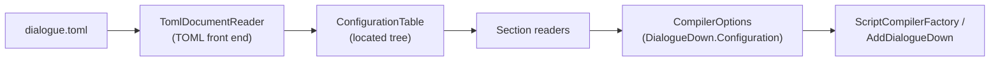
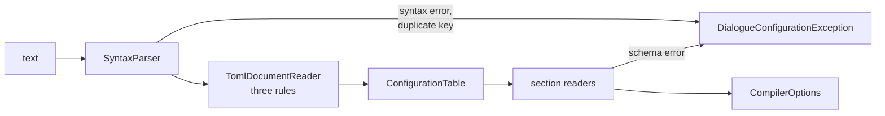

# Configuration Loader

> [!NOTE]
> Status: **implemented**. `TomlConfigurationLoader` reads a project's
> `dialogue.toml` into a [`CompilerOptions`](./Configuration.md), validating it
> first. It is a separate assembly, `DialogueDown.ConfigurationLoader`, so the core
> never takes a TOML dependency. A setting means the same thing in every TOML
> spelling, and an unknown key anywhere in the file is an error.

## Table of contents

- [Where it sits](#where-it-sits)
- [Ubiquitous language](#ubiquitous-language)
- [The `dialogue.toml` schema](#the-dialoguetoml-schema)
- [Interfaces and abstractions](#interfaces-and-abstractions)
- [Key design decisions](#key-design-decisions)
- [Error and boundary cases](#error-and-boundary-cases)
- [Testability](#testability)

## Where it sits



`TomlConfigurationLoader` composes the two halves: the TOML front end turns text
into a located tree, and the section readers turn the tree into options. The
readers never see TOML syntax.

The loader depends on the core and Tomlyn only; the core never depends on the
loader. An architecture test guards both directions. A consumer that builds
`CompilerOptions` in code does not reference the loader at all.

## Ubiquitous language

| Term | Meaning |
| --- | --- |
| **Section** | A top-level key the schema defines: `mode`, `speakers`, or `markdown`. |
| **Section reader** | An internal reader that owns one section and maps it to options. |
| **Spelling** | One of the TOML forms that write the same setting: a `[table]` or `[[array]]` header, an inline table or array, or a dotted key. |
| **Located tree** | The format-neutral tables, arrays, and scalars a front end produces, each carrying the source location it was written at. |
| **Structural key** | A speaker key the schema defines: `name`, `id`, `tags`. |
| **Reserved key** | Any other speaker key — a reserved tag, validated against `ReservedTagNames.Known`. |
| **Tag shorthand** | A custom tag written as in the DSL: `"name"` or `"name=value"`. |
| **Edge validation** | Rejecting a malformed config here, before it reaches the compiler. |

## The `dialogue.toml` schema

```toml
mode = "best-effort"                  # stage-boundary (default) or best-effort

[[speakers]]
name    = "Narrator"                  # required, non-empty
id      = "narrator"                  # optional, non-empty
default = true                        # a reserved key → ReservedTag("default")
tags    = ["main", "mood=happy", { name = "a=b", value = "c" }]   # custom tags

[markdown.unmodeled]
table      = "keep"                   # keep or ignore, per kind
code-block = "ignore"
```

| Key | Maps to |
| --- | --- |
| `mode` | `CompilerOptions.Mode`; only the two settable modes (see [Compilation Mode Configuration](./Compilation%20Mode%20Configuration.md)). |
| `speakers` | `CompilerOptions.Speakers`, one `ConfiguredSpeaker` per table, in document order. |
| `name`, `id` | `ConfiguredSpeaker.Name`, `Id`. |
| `tags` | `CustomTags`: a shorthand string split at the first `=`, or a table `{ name, value? }` for a name that itself contains `=`. |
| any other speaker key | `ReservedTags`: `true` → a name-only tag, a string → a valued tag, `false` → nothing. |
| `markdown.unmodeled` | `CompilerOptions.UnmodeledMarkdown`; omitted kinds stay absent so their defaults apply (see [Unmodeled Markdown Handling](../core/Unmodeled%20Markdown%20Handling.md)). |

Every spelling of a setting is read the same way. Each group below configures
one thing:

```toml
[[speakers]]                                   # an array header
name = "Alice"

speakers = [{ name = "Alice" }]                # an inline array of tables
```

```toml
[markdown.unmodeled]                           # a table header
table = "keep"

markdown.unmodeled.table = "keep"              # a dotted key

markdown = { unmodeled = { table = "keep" } }  # an inline table
```

## Interfaces and abstractions

| Type | Visibility | Responsibility |
| --- | --- | --- |
| `TomlConfigurationLoader` | public | `Load(path)` and `Parse(toml, sourceName)` → `CompilerOptions`; runs the front end, rejects unknown sections, and composes the readers. |
| `TomlDocumentReader` | internal | The TOML front end: text → a located `ConfigurationTable`, failing on a syntax error or a duplicate key. The only type that uses Tomlyn. |
| `ConfigurationValue` | internal | The located tree: an abstract record with a `Location`, whose cases are `ConfigurationTable`, `ConfigurationArray`, and `ConfigurationScalar`. |
| `ConfigurationEntry` | internal | One key of a table: its name, the location of the key, and its value. |
| `ConfiguredModeReader`, `ConfiguredSpeakerReader`, `ConfiguredUnmodeledReader` | internal | One section each, read from the root `ConfigurationTable`. |
| `DialogueConfigurationException` | public | A config error with its `ConfigurationSourceLocation`. |
| `ConfigurationSourceLocation` | public | The source, line, and column of a config error. |

## Key design decisions

### D1 — TOML

Weighed against INI, JSON, and YAML for sectioning, readability to writers and
developers, editor support, and standardization:

| Format | Verdict |
| --- | --- |
| **TOML** (chosen) | Explicit `[section]` headers, comments, real types, a published standard (used by Cargo and `pyproject.toml`), and schema-aware editor support (Even Better TOML / Taplo). |
| YAML | Readable, but whitespace-sensitive — a hazard for non-technical writers. |
| JSON | No comments, noisy to hand-edit. |
| INI | No standard, no validation, no nested sections. |

The format is chosen for the people who type the file. Either format needs a
front end of about the same size, so the choice does not rest on code: TOML has
comments, needs no commas, and lets the starter file teach the schema in
commented-out examples. JSON would be reconsidered only if writers stopped typing
the file, for example behind a settings form.

### D2 — A satellite assembly on Tomlyn

Tomlyn is the de facto .NET TOML library — by the author of Markdig, used by the .NET
SDK — and it reports precise line and column locations, which edge validation
needs. The project name does not name the format; `TomlConfigurationLoader` does.

### D3 — One front end builds a located tree; section readers never see TOML

TOML can write one setting in several spellings (see
[the schema](#the-dialoguetoml-schema)). A reader that finds a section by its
syntax shape, such as a `[[speakers]]` header, misses the other spellings without
a word. So the spellings are resolved once, in the front end, and the section
readers work on the result:

1. **Parse and validate.** Tomlyn's `SyntaxParser` parses the text. A syntax error,
   a duplicate key, or a table defined twice fails here with Tomlyn's message and
   location.
2. **Build the located tree.** `TomlDocumentReader` walks the syntax tree once and
   builds a `ConfigurationTable`. Because Tomlyn has already rejected every
   redefinition, three rules cover every spelling:
   - a dotted key steps into a table;
   - a header steps into the last table of an array of tables;
   - a table that a key or header steps into is created when it does not exist yet.

   Every node of the syntax tree has a span, so every header, key, value, and array
   element in the tree has its own location.
3. **Read sections.** Each section reader maps its part of the tree to options and
   rejects what is invalid, locating the error at the key, value, table, or array
   element at fault.



The three rules are hand-written, so a test holds them to Tomlyn's own reading:
for each spelling, the tree without its locations equals the `TomlTable` that
`TomlSerializer` builds from the same text. The front end throws nothing but
`DialogueConfigurationException`, which is what the CLI and the live editor catch.

Rejected alternatives, each tried against Tomlyn 2.10.1:

| Alternative | Why not |
| --- | --- |
| Bind a POCO with `TomlSerializer`, unknown keys in `[TomlExtensionData]` | The serializer keeps the last of two duplicate keys instead of rejecting it, records no location for a scalar array element, and records no locations at all when source-generated. The POCO would hold `object?` values anyway, so validation stays in hand-written readers. |
| Deserialize to Tomlyn's `TomlTable` model | Records no location for an array element. It also loses data when a header reopens an array of tables after another header: it keeps only the later entries, and `[speakers.voice]` there replaces the whole array. |
| Tomlyn's streaming `TomlReader` | Gives no location for a table opened by a header, and returns a table reopened after another header as two separate tables. |
| Each section reader walks the syntax tree | Every spelling is a different syntax shape, so each reader would repeat TOML's table rules, and a spelling one forgets is ignored without an error. |

The tree is format-neutral: a JSON front end would build the same
`ConfigurationTable`, and the section readers would not change.

### D4 — Reserved tags as typed keys, custom tags as DSL shorthand

`default = true` is caught at the edge against the shared reserved set, and a
multi-word reserved name comes free with TOML key quoting. Custom tags reuse the
script syntax, with the table form for the one case shorthand cannot express.
Both become `ConfiguredTag`.

### D5 — Validate at the edge, fail with a location

The loader rejects anything the compiler would mishandle as a
`DialogueConfigurationException` carrying the path, line, and column, so the compiler
trusts its `CompilerOptions`. It stops at the first problem, checking in a fixed
order: the TOML itself, then unknown sections, then `speakers`, `mode`, and
`markdown`, each in document order.

### D6 — An unknown key is an error at every level

A key the schema does not define is rejected, whether it sits at the root
(`modee`, `[[speaker]]`), under `[markdown]` (`[markdown.unmodled]`), or in a
speaker or unmodeled table. The error names the key and lists the keys allowed
there.

The alternative, ignoring unknown root keys so an older `ddown` can read a file
written for a newer one, was weighed and rejected. A writer's typo is far more
common than a version mismatch, and an ignored setting is silent: the compile runs
on defaults and nothing says why. A newer setting rejected by an older tool names
itself, which tells the writer to upgrade.

A new section is added by giving it a section reader and listing its key among
the known sections in `TomlConfigurationLoader`.

## Error and boundary cases

Every error is a `DialogueConfigurationException`. The location column says where
it points.

| Case | Location |
| --- | --- |
| Malformed TOML, a duplicate key, or a table defined twice | Tomlyn's diagnostic, with its message. |
| Unknown section (`modee = …`, `[[speaker]]`) | The key. |
| Unknown key under `[markdown]` | The key. |
| `speakers` that is not an array of tables, or a speaker that is not a table | The value or element. |
| Missing `name` | The speaker's table: its header, or its `{` when inline. |
| Empty `name` or `id`, or a non-string one | The value. |
| Unknown speaker key | The key. |
| Reserved key that is neither a boolean nor a string | The value. |
| `tags` that is not an array, or a tag that is neither a string nor a table | The value, or the element at fault. |
| Tag table without `name`, or with a key other than `name` and `value` | The table, or the key's value. |
| A second `default = true` | The second default speaker's table. |
| Unknown, non-string, or `fail-fast` `mode` | The value. |
| `markdown` or `markdown.unmodeled` that is not a table | The value. |
| Unknown unmodeled kind | The key. |
| Unknown or non-string handling | The value. |

A dotted key is a nested table by TOML's own rules, so `mode.strategy = "…"` is a
`mode` that is not a string, and `name.first = "…"` is a `name` that is not a
string.

Boundary cases:

| Case | Behavior |
| --- | --- |
| Empty file | `CompilerOptions.Default`. |
| An empty `[markdown]` or `[markdown.unmodeled]` | No overrides. |
| `Load` on a missing file | The underlying I/O exception. |
| Duplicate speaker names | Left to the binder, which already reports conflicts. |

## Testability

- Tests are snippet-in, options-or-error-out through `TomlConfigurationLoader.Parse`:
  each section reader's test file states the TOML and what the loader makes of it.
- Every section has a test per spelling, asserting the same options.
- Every schema error asserts its whole message, line, and column. A message Tomlyn
  writes is checked by its line and the words that name the fault.
- `TomlDocumentReader` has its own tests for what only the front end decides: the
  tree equals Tomlyn's `TomlTable` for each spelling, a header reopened after
  another header keeps every table, every node is located, and Tomlyn's syntax
  and duplicate-key errors pass through.
- Core tests prove both composition roots apply loaded speakers and handling.
- Architecture tests guard the dependency direction, and that only the
  `DialogueDown.ConfigurationLoader.Toml` namespace depends on Tomlyn.
