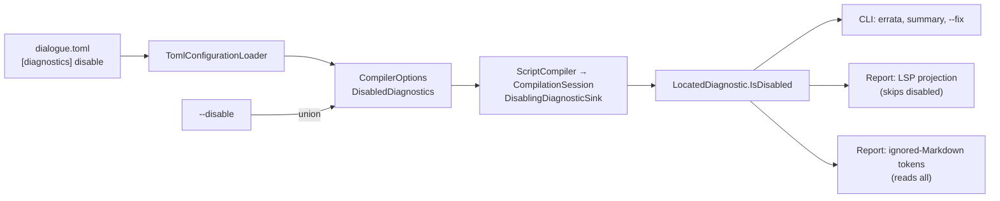

# Disabled Diagnostics

> [!NOTE]
> Status: **proposed**, in review. How a writer turns a diagnostic off **by code**:
> a `[diagnostics]` table in `dialogue.toml` for the whole project, and
> `ddown compile --disable` for one run. A disabled diagnostic is still computed and
> carried, marked as disabled, so each surface decides how to show it. This note
> covers the core, the configuration loader, and the CLI; the report's controls are
> [planned](#planned-the-report).

## Table of contents

- [Goal and scope](#goal-and-scope)
- [Ubiquitous language](#ubiquitous-language)
- [Functionality checklist](#functionality-checklist)
- [Where it sits](#where-it-sits)
- [The `dialogue.toml` table and the CLI option](#the-dialoguetoml-table-and-the-cli-option)
- [Interfaces and abstractions](#interfaces-and-abstractions)
- [Key design decisions](#key-design-decisions)
- [Error and boundary cases](#error-and-boundary-cases)
- [Testability](#testability)
- [Planned: the report](#planned-the-report)
- [Not built](#not-built)
- [Open questions](#open-questions)

## Goal and scope

Every `Info` and `Warning` is shown on every compile, whether or not the writer has
decided it does not apply to their project. A note that fires out of habit, such as
`DLG3002` in a project that nests choices deeply on purpose, buries the notes that
matter.

This component lets a writer disable an optional code for a project or a run, and
makes every existing surface honor it: the CLI's errata, summary, fix mode, and
fixable hint, and the report's diagnostics. The report's own controls for disabled
diagnostics (a muted Problems group, row actions that edit `dialogue.toml`, code
autocompletion in the Config tab) are the next component. Until then the report
hides disabled diagnostics.

## Ubiquitous language

| Term | Meaning |
| --- | --- |
| **Disable** | Turn a diagnostic code off for a project or a run. The verb in TOML (`disable`), on the CLI (`--disable`), and in code (`DisabledDiagnostics`). |
| **Disabled diagnostic** | A diagnostic whose code is disabled. It keeps its code, span, severity, message, and fixes, and carries `IsDisabled`. |
| **Optional code** | A code whose default severity is `Info` or `Warning`, so it can be disabled. An `Error` code is never optional. |
| **Enabled diagnostic** | Any diagnostic that is not disabled: what a surface shows by default. |

The word is *disabled*, never *ignored* or *suppressed*. *Ignored* already means
[ignored Markdown](Ignored%20Markdown%20Diagnostic.md), which `DLG1114` reports and a
writer could disable. *Suppressed* reads as a per-site comment in the script, which
this component does not offer.

The report also uses *disabled* for unavailable controls, such as a stage tab with no
artifact. The planned Problems group must word its rows so a disabled diagnostic is
not mistaken for a disabled control, for example "Disabled in dialogue.toml".

## Functionality checklist

- [ ] `DiagnosticCatalog.All` lists every descriptor explicitly, and a public
      `DiagnosticCodes` query exposes each code's title, category, and default
      severity.
- [ ] `CompilerOptions.DisabledDiagnostics`: a set of optional codes, empty by
      default, normalized to upper case, compared as a set.
- [ ] `Diagnostic.IsDisabled` and `LocatedDiagnostic.IsDisabled`, set during the
      compile for every non-error diagnostic whose code is disabled.
- [ ] `HasErrors`, the compile's outcome, the stage-boundary halt, and exit codes are
      unchanged.
- [ ] `[diagnostics] disable = [...]` in `dialogue.toml`, with a located
      `DialogueConfigurationException` for every malformed shape, an unknown code,
      or an `Error` code.
- [ ] `ddown compile --disable <code>`, repeatable and comma-separated, added to the
      configured set; an unknown or `Error` code is a usage error.
- [ ] The CLI prints no disabled diagnostic, and the summary line adds `N disabled`.
- [ ] `--fix` ignores disabled diagnostics: it applies none of their fixes and counts
      none of them in the hint, the remaining count, or the "after fixing" list.
- [ ] The report shows no squiggle, gutter marker, Problems row, or "Fix all" entry
      for a disabled diagnostic, and still colors ignored Markdown from a disabled
      `DLG1114`.
- [ ] Guides: `[diagnostics]` in the configuration guide, `--disable` in the CLI
      guide, and which codes are optional in the error-code reference.

## Where it sits

The set travels with the other options. The compile marks each diagnostic as it is
reported, so every surface reads one flag and none re-derives the rule.



## The `dialogue.toml` table and the CLI option

```toml
# dialogue.toml
[diagnostics]
disable = ["DLG3002", "DLG1114"]   # any order; duplicates collapse
```

```bash
ddown compile scene.dialogue.md --disable DLG1003            # adds to the configured set
ddown compile scene.dialogue.md --disable DLG1003,DLG3004    # same as two --disable options
```

**Precedence: the configured set ∪ `--disable`.** `CompileCommand` builds the union
after resolving the configuration, the way it applies `--mode`:
`options with { DisabledDiagnostics = options.DisabledDiagnostics.Union(settings.Disable) }`.
The option only adds, like Ruff's `--extend-ignore`, so a run cannot re-enable a
code the project disabled.

A well-formed code is `DLG` followed by four digits, matched case-insensitively.

With `DLG3002` disabled, a piped compile that finds one warning and one disabled
diagnostic prints:

```text
scene.dialogue.md(3,27): warning DLG1113: `=>` makes a jump only when a link follows it. …
  for more information, see https://pengzhengyi.github.io/dialoguedown/guide/error-codes.html#dlg1113
1 warning, 1 disabled
```

## Interfaces and abstractions

| Type | Visibility | Responsibility |
| --- | --- | --- |
| `DiagnosticCatalog.All` | internal | An explicit array of every descriptor; a test checks it against the reflected fields. |
| `DiagnosticCodes` | public | The catalog's public face: `All` as `DiagnosticCodeInfo(Code, Title, Category, DefaultSeverity)` in code order, `Find(code)`, and `IsOptional(code)`. Descriptors stay internal. |
| `CompilerOptions.DisabledDiagnostics` | public | An `ImmutableHashSet<string>` with an ordinal comparer, holding upper-case codes; validated on `init`. |
| `CompilerOptions(mode, speakers, unmodeled, disabledDiagnostics)` | public | A new constructor overload; the existing three-argument one stays. |
| `DisablingDiagnosticSink` | internal | An `IDiagnosticSink` decorator over a set of code strings: marks a non-error diagnostic whose code is in the set, then forwards it. |
| `Diagnostic.IsDisabled`, `LocatedDiagnostic.IsDisabled` | internal, public | The mark, an `init` property on both (not a positional parameter), included in equality. |
| `ConfiguredDiagnosticsReader` | internal | Reads and fully validates `[diagnostics]` from the TOML syntax tree. |
| `CompileSettings.Disable` | internal | The `--disable` values, split at commas, trimmed, validated with `DiagnosticCodes`. |

## Key design decisions

### D1 — A code is the unit, and only an optional code can be disabled

Every tool in the prior art disables by code, never by message or category alone.
An `Error` means the compile cannot produce a correct playbook, so disabling one
would let a broken script pass. C# `NoWarn` and Rust's hard errors draw the same
line.

Whether a code is optional follows its descriptor's **default** severity. No
reporting site overrides a severity today, but `Diagnostic` allows it, so the sink
also checks the diagnostic's own severity and never marks an error. A future
severity map (see [Open questions](#open-questions)) would revisit this rule.

Because no disabled diagnostic is ever an error, `HasErrors`, the compile's outcome,
the stage-boundary halt, and the exit code need no change.

### D2 — Mark, do not drop

A disabled diagnostic is still computed and carried, like Roslyn's
`Diagnostic.IsSuppressed`. Two consumers need that:

- the report's planned Problems group lists disabled diagnostics so a writer can
  re-enable one;
- the editor colors ignored Markdown from `DLG1114`'s spans
  ([Unmodeled Markdown Highlighting](../visualization/editor/Unmodeled%20Markdown%20Highlighting.md)
  D2), so dropping a disabled `DLG1114` would silently remove the coloring.

The mark is part of equality on both `Diagnostic` and `LocatedDiagnostic`. Unlike
`Fixes`, which only suggests a repair, the mark changes how a consumer must show the
diagnostic, so a consumer that caches by equality must see it change, and a test
that compares diagnostics catches a marking regression. It is an `init` property, not
a positional parameter, so `LocatedDiagnostic`'s deconstruction does not break. No
existing comparison changes: without a disabled set, every diagnostic is enabled, as
before.

### D3 — Mark in a sink decorator, during the compile

`ScriptCompiler` takes the set beside the mode, and `CompilationSession.Start(source,
mode, disabledDiagnostics)` wraps the mode's sink in a `DisablingDiagnosticSink` when
the set is non-empty. The decorator is outermost, so it marks before the bag (or the
fail-fast sink) sees the diagnostic. It takes a set of strings, not
`CompilerOptions`, so the `Diagnostics` namespace stays a foundation leaf.

This gives one marking site for every composition root, and reporting sites stay
unaware, as they are of the mode
([Diagnostics and Validation](Diagnostics%20and%20Validation.md) D6). Marking once
while `ScriptCompiler` assembles the result would work too, but it would have to be
repeated on each result path (success and each failure), while the sink sees every
diagnostic exactly once. Marking in the CLI would leave the library and the report
to re-derive the rule.

### D4 — A flat set on `CompilerOptions`

`DisabledDiagnostics` sits beside `Mode` and `UnmodeledMarkdown`
([Configuration](../configuration/Configuration.md) D6). A future severity map
would be a sibling property, not a reshaping. The set is stored upper-case with an
ordinal comparer, through a backing field marked `[IgnoreEquality]` and a property
compared with `[UnorderedEquality]`, the pattern `UnmodeledMarkdown` uses. Because `init`
normalizes the codes to upper case, the getter returns a new set, not the instance
assigned.

`CompilerOptions` validates the set on `init` and throws `ArgumentException` for an
unknown or `Error` code. A code-level consumer that passes one is misusing the API,
which the [Error Model](../core/Error%20Model.md) routes to the standard .NET channel.
The loader validates first and reports its own located error, so a writer never sees
the `ArgumentException`, and the served report, which catches only
`DialogueConfigurationException` when it reloads `dialogue.toml`, never crashes on one.

### D5 — A public `DiagnosticCodes` query, not wider internals

The loader and the CLI must check a code against the catalog, which is internal.
Rather than add an `InternalsVisibleTo` for the loader, the core exposes a small,
read-only view. Each entry carries the title and default severity because the
planned Config tab autocompletion shows them. It reads an explicit
`DiagnosticCatalog.All` array, not reflection, so it survives trimming in engine
builds; a test keeps the array complete.

Codes match case-insensitively, so `dlg3002` and `DLG3002` are one code.

### D6 — Strict validation at the edge

An unknown or `Error` code in `disable` is a located `DialogueConfigurationException`,
as every other config problem is
([Configuration Loader](../configuration/Configuration%20Loader.md) D5). A typo such
as `DLG302` that silently does nothing is the failure this feature most needs to
avoid, and the lenient alternative, a warning like Rust's `unknown_lints`, needs a
warning channel the loader does not have. On the CLI the same check is a usage error
(exit `64`).

The cost is that changing the catalog can break a project's config on upgrade:
promoting a code to `Error`, or a config naming a code newer than the installed
`ddown`. The [Error Model](../core/Error%20Model.md) already never renumbers or
repurposes a code; promoting one to `Error` becomes a breaking change that the
changelog calls out.

The `[diagnostics]` table is validated as strictly as `[markdown.unmodeled]`: any
other spelling of the root `diagnostics` key, such as an inline table, a dotted key,
or an array of tables, is an error rather than silently ignored. A misspelled table
name such as `[diagnostic]` is an unrelated root key, which the loader ignores for
forward compatibility.

### D7 — The CLI filters disabled diagnostics and counts them

`ErrataRenderer` filters disabled diagnostics before anything else, so neither the
blocks, nor the "print nothing when clean" check, nor the fixable hint sees them.
The summary line prints whenever an enabled diagnostic of any severity prints, and
then ends with `N disabled` when any were disabled. The fix run's
remaining count reuses the summary but leaves the disabled count out.

A compile whose only diagnostics are disabled prints nothing, as a clean compile
does. A standalone `N disabled` line would make every compile of a project that
disabled a habitual note print something, which is the noise the writer turned off.
No `--show-disabled` option is built.

### D8 — Fix mode respects the disabled set

`FixApplier` drops disabled diagnostics before choosing preferred fixes, so they are
not candidates at all, rather than recorded as skipped. A run whose only fixable
diagnostics are disabled therefore prints no fix section. The "after fixing" list
excludes them too. Rewriting text the writer chose not to hear about would surprise
them. To fix a code the project disabled, a writer removes it from `dialogue.toml`;
the CLI cannot re-enable it for one run.

### D9 — `--disable` is a `compile` option only

Like `--mode`, it tunes one run. `visualize` honors the configured set, and a writer
changes it in the report through `dialogue.toml`. With `--emit dot`, `--disable` is
accepted and has no effect, since that path prints no diagnostics.

### D10 — Until the report component, the report hides disabled diagnostics

`DiagnosticProjection` skips disabled diagnostics. Because the report's squiggles,
gutter markers, Problems rows, and "Fix all" with its counts all read that payload,
none of them shows a disabled diagnostic. `SemanticTokenProjection` keeps reading
every located diagnostic, so ignored-Markdown coloring survives. The report already
reloads `dialogue.toml` through the loader and applies options with `with`, so the
set reaches it with no other change. The next component replaces the skip with a
disabled group.

## Error and boundary cases

| Case | Behavior |
| --- | --- |
| No `[diagnostics]` table, or `disable = []` | Nothing disabled; the options equal `CompilerOptions.Default` when nothing else is set. |
| Only `[diagnostics]` set | Loaded; the loader's "nothing set → `Default`" shortcut also checks the set. |
| `disable` is not an array, or holds a non-string | Located `DialogueConfigurationException`. |
| An unknown or malformed code (`DLG12`, `DLG302`) | Located `DialogueConfigurationException`, naming the code. |
| An `Error` code | Located `DialogueConfigurationException`, saying errors cannot be disabled. |
| An unknown key in `[diagnostics]` | Located `DialogueConfigurationException`, as in `[markdown.unmodeled]`. |
| `diagnostics` as an inline table, dotted key, or array of tables | Located `DialogueConfigurationException`. |
| `[diagnostic]` (misspelled) | Ignored, like any unrelated root key. |
| A duplicate code, or one code in two cases | One entry. |
| `--disable` with an unknown or `Error` code | Usage error, exit `64`. |
| `--disable ""` or `--disable ","` (no code at all) | Usage error, exit `64`. |
| `--disable dlg1003` or `--disable " DLG1003 "` | Accepted as `DLG1003`. |
| `--disable DLG1003,` (trailing comma) | The empty entry is dropped; `DLG1003` is disabled. |
| An empty or whitespace string in `disable` | Located `DialogueConfigurationException`, as a malformed code. |
| `" DLG1003 "` in `disable` | Located `DialogueConfigurationException`; TOML values are taken as written, apart from case. |
| `--disable` naming a code the config already disables | No effect. |
| `--disable` with `--emit dot` | Accepted; no effect. |
| A disabled code that never fires | Nothing reported; unused-disable reporting is not built. |
| Only disabled diagnostics | Nothing printed; exit `0`. |
| Only disabled diagnostics carry fixes, under `--fix` | No fix section; the diagnostics print as a plain compile would. |
| `CompilerOptions` built in code with an unknown or `Error` code | `ArgumentException`. |

## Testability

- `DiagnosticCatalog.All` matches the reflected descriptor fields; `DiagnosticCodes`
  agrees with it entry by entry.
- `CompilerOptions`: empty by default; codes normalize; equality ignores order and
  case; an unknown or `Error` code throws; the three-argument constructor still
  works.
- `DisablingDiagnosticSink`: marks a code in the set, forwards the rest unchanged,
  and never marks an error, even one with an overridden severity.
- Composition roots: a real compile with a disabled code marks it, keeps its span and
  fixes, and leaves `HasErrors` unchanged, through both `ScriptCompilerFactory` and
  `AddDialogueDown`.
- Loader: raw-string TOML to the expected set, and one test per error case asserting
  the location; an invalid code never surfaces as `ArgumentException`.
- CLI through `CommandAppTester`: `--disable` unions with the config; each parsing
  edge case; an invalid code exits `64`; disabled diagnostics are not printed.
  `ErrataRenderer` on a `TestConsole` for the summary, the hint, and the remaining
  count. Fix mode: disabled fixes are not applied, and a run with only disabled
  fixes prints no fix section.
- Report: `DiagnosticProjection` skips a disabled diagnostic, and
  `SemanticTokenProjection` still colors a disabled `DLG1114`.

## Planned: the report

The next component gives the report its own controls, through the Config tab's
existing TOML editing, which can already create the file in place:

- the Problems panel lists disabled diagnostics in a muted group, or behind a
  filter;
- an enabled row offers **Disable DLG3002 in dialogue.toml**, a disabled row offers
  **Enable**, and either recompiles;
- the Config tab autocompletes codes in `disable` from `DiagnosticCodes.All`, carried
  to the client in a new configuration-report field, like the reserved tags.

It will be a section of this note.

## Not built

| Knob | Why not now |
| --- | --- |
| A severity map (`DLG3002 = "error"`) | See [Open questions](#open-questions). |
| Inline suppression in a script (`<!-- ddown-disable-next-line -->`) | The front end discards comments today; a follow-up, with unused-suppression reporting. |
| Per-file scope in `dialogue.toml` | A follow-up; the CLI resolves one configuration per run. |
| Re-enabling a configured code from the CLI | No known need; the option only adds. |
| `--show-disabled` | The summary count covers awareness; the report covers browsing. |

## Open questions

The checklist and decisions above follow my leaning on each question; a different
answer changes the decision it names.

1. **List or severity map.** I lean the list: it is the smallest thing that works,
   and a map can be added later as a sibling (`[diagnostics.severity]`) without
   breaking `disable`. A map designed now would also have to decide whether a
   warning promoted to an error fails the compile, a larger change to the outcome
   rules.
2. **Strict or lenient for unknown codes.** I lean strict (D6). The alternative
   accepts a well-formed but unknown `DLG####`, so a config survives a version skew,
   at the price of letting a typo through.
3. **The CLI count.** I lean the `N disabled` count on an existing summary line (D7)
   over printing nothing or adding `--show-disabled`.
4. **Comma-separated `--disable`.** I lean yes, matching Ruff, at the cost of one
   more parsing rule.
