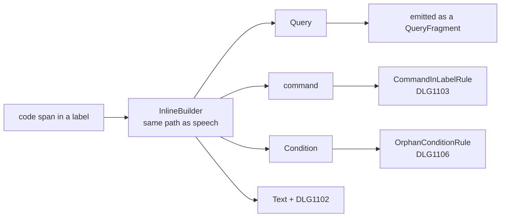

# Game Calls in Labels

> [!NOTE]
> Status: **implemented**. A query may stand in a label and is filled like one in
> speech; a command in a label reports `DLG1103` and a condition reports `DLG1106`.

A label is the text inside a link's brackets, a jump's included, or the alt text
of an image. Each is shown as one piece, so nothing inside it gets a moment of its
own in the conversation. This note settles which game calls a label may hold,
and how the compiler says so when a writer puts the wrong one there.

## Table of contents

- [Ubiquitous language](#ubiquitous-language)
- [Goal and scope](#goal-and-scope)
- [Writer-facing behavior](#writer-facing-behavior)
- [Functionality checklist](#functionality-checklist)
- [Key design decisions](#key-design-decisions)
- [Interfaces and abstractions](#interfaces-and-abstractions)
- [Error and boundary cases](#error-and-boundary-cases)
- [Integration](#integration)
- [Testing and demonstration](#testing-and-demonstration)

## Ubiquitous language

| Term | Meaning |
| --- | --- |
| **Label** | The inline text inside a link's brackets or an image's alt text. A link after `=>` becomes a jump; when the jump is a menu option, its label is what the menu shows. |
| **Game call** | A code span that talks to the game: a **query** (`` `"key"` ``) reads a value into the words, a **command** (`` `Wave()` ``, `` `("wave")` ``) asks the host to do something. |
| **Condition** | A code span ending in `?` (`` `"key"?` ``) that guards what follows it. Not a game call, but written in the same backticks. |
| **Moment** | A point in a playthrough where the host performs a command: at a node, or between the words of a line. A link, an image, and a menu option are each shown whole, so a label has no moment inside it. |

## Goal and scope

A writer can put a value into a label the way they put one into speech, and a
game call that cannot work in a label is reported instead of vanishing into
literal text. This covers every label: an inline link, an image's alt text, and a
jump, whether it is a menu option or a divert.

In scope:

- Admit a query in a label, so it reaches the playbook as a `QueryFragment`.
- Report a command in a label with `DLG1103`.
- Report a condition in a label with `DLG1106`, the code for a condition that
  guards nothing.
- Report a code span in a label that is not a game call with `DLG1102`, as in
  speech.

Out of scope, and each designed separately:

- **A game call in a scene heading.** A heading is never shown to a player, so it
  needs its own rule rather than this one.
- **A linked image** (`[](#x)`). The image inside a link is still
  restored to its Markdown text, along with any query in its alt text.
- **Offering a menu.** [Offering a Choice](../runtime/Offering%20a%20Choice.md)
  owns how the runner shows an option's label: it asks for the label's queries
  when it reaches the menu, and offers the label with its commands left out. An
  option written without a jump (`` - Random Armor `AddToInventory("Armor")` ``)
  takes its label from its own words, command included. The menu leaves that
  command out, and the option's line performs it when the option is chosen.

## Writer-facing behavior

| Script | Result |
| --- | --- |
| ``Alice: See [the `"PlaceName"` inn](#inn).`` | label `the {PlaceName} inn`, filled at run time |
| ``Alice: `` | a query in the alt text |
| ``- => [Ask `"CompanionName"` to join](#join)`` | the option's label carries the query |
| ``- => [Leave `SlamDoor()`](#exit)`` | `DLG1103` |
| ``Alice: [Talk to `Wave()`](#inn)`` | `DLG1103` |
| ``Alice: [Only if `"Met"?`](#inn)`` | `DLG1106` |
| ``Alice: [see `config.toml`](#inn)`` | `DLG1102`, as the same code span in speech reports |

A command in a menu option is the case a writer is most likely to reach for, so
the message names the remedy that works there. Written before the jump, the
command runs when the option is chosen:

```markdown
- `SlamDoor()` => [Leave](#exit)
```

```text
scene.dialogue.md(9,13): error DLG1103: `SlamDoor()` is a command, and nothing
inside a label or alt text runs. Move it outside the brackets; before `=>`, it
runs when the jump is taken.
```

The message shows the command with its arguments, so a writer can find it in a
label that holds several. The rule sees the built node rather than the source, so
it writes the command back out in canonical form with
`GameCallExtensions.Canonical`: `GiveQuest("EmberCrown")` for a named command,
`("wave")` for a default one.

## Functionality checklist

- [x] A query in a link label, an image's alt text, or emphasis inside either
      builds as a `Query`.
- [x] A query in a jump's label reaches the option's or the divert's label in the
      playbook.
- [x] A command in any label reports `DLG1103` at the code span.
- [x] A condition in any label reports `DLG1106` at the code span.
- [x] A code span in a label that is not a game call reports `DLG1102` once.
- [x] A command, query, or condition in speech outside a label reports nothing new.
- [x] A soft break, nested link, or image in a label keeps its literal text.
- [x] The two properties in [Property tests](#property-tests) hold, and their
      coverage guard passes.
- [x] The gallery example and the conformance corpus pin a query in a label.
- [x] `DLG1103` has a compiled example in the error-code reference.
- [x] The writer's guide says where a query may stand, and the diagnostics example
      shows `DLG1103`.

## Key design decisions

### D1 — A query may stand in a label; a command may not

A query is a read that yields words, and a label is words, so the two fit. A
place name in a link, a companion's name in a portrait's alt text for a screen
reader, and a character's name in a menu option are ordinary needs.

A command is a write that happens at a moment, and a label has no moment inside
it. Drawing a menu must not change the world, and the format already says so
twice:

- `SegmentBuilder` treats a link or an image as one word, so a command inside one
  never becomes the command a segment performs.
- `OptionEdge.Label` is compiled into the edge so that presenting a menu keeps it
  free of side effects.

A command in a label is therefore one the runner will never perform. Rejecting it
is the compiler agreeing with the format, not a new restriction.

### D2 — The transpiler builds the call; a structural rule rejects the command

A label's policy decides which Markdown elements a label builds. A code span is a
query or a command only once its content is parsed, and it parses the same way
wherever it stands. So the label policy admits the code span and builds it exactly
as speech does, and a rule on the desugared tree decides where a command may
stand:



| Option | For | Against |
| --- | --- | --- |
| **A structural rule** (chosen) | Follows `OrphanConditionRule`, which already rejects a condition standing where it cannot act. The policy keeps deciding only about Markdown. One rule covers link, image, and jump labels, since it runs after desugar. Every composition that builds a transpiler, `ScriptCompilerFactory` and the DI registration, also runs the validator. | The rule reports without recovering, so the command stays in the tree. No playbook ever carries it, because a compile with an error writes none in either mode. A failed compile's tree keeps it, as it keeps an orphan condition in speech. |
| A second gate on `IInlinePolicy` | The policy remains the one place that says what a label holds, and the command is dropped at the earliest stage. | Adds a member for a decision that is not about parsing, and splits a code span's handling between the builder and the policy. `SupportsJumps` is not a precedent: it decides whether `=>` is tokenized at all. |

The evidence survives desugar, which is what lets a rule see it. The
[dangling arrow](../diagnostics/Dangling%20Arrow%20Diagnostic.md) is the opposite
case: desugar turns a stray `=>` into ordinary text, so that one is reported where
it is dropped.

### D3 — `DLG1103` reports a command in a label

`DLG1103` covers commands only: a condition in a label has its own code (D4), and
a code span that is not a game call reports `DLG1102` (D6).

Its title is "Command in a label". Its message shows the command with its
arguments, says why it cannot run, and gives the remedy from
[Writer-facing behavior](#writer-facing-behavior). It stays an error: the writer
asked for something to happen, and it never would.

### D4 — A condition in a label reports `DLG1106`

`OrphanConditionRule` walks every node, labels included, and a condition in a
label is bound to nothing. Its message already tells the writer both ways out: put
the condition before the `=>` to guard the jump, or drop the `?` to write a query.
Both are the right advice inside a label, so the condition needs no code of its
own.

### D5 — Everything else in a label keeps its literal fallback

Only the code span changes. A soft break in a label is still read as a space, since
a label wrapped across two source lines is ordinary Markdown. A nested link or
image is still restored to its text, and so `LabelInlinePolicy` keeps its way of
writing a code span back out: a linked image's alt text can hold one. Admitting a
linked image is separate work.

### D6 — A code span in a label means what it means in speech

Once a label builds code spans, one that is not a game call reports `DLG1102`,
exactly as in speech. A label, like speech, cannot use backticks for code-styled
text.

### D7 — A divert label may hold a query that no runner fills

A jump that is not a menu option is a divert, and its label is carried in
`DivertEdge.Label` for a host that may show it, use it as a hint, or ignore it. No
runner shows it: the protocol's events carry no edge label, and a divert is taken
silently. A query there is admitted all the same, and nothing fills it.

The same written jump is often both kinds of label at once. A menu option written
as a jump becomes the option's label and also a divert on the option's own node:

| Written | Compiles to |
| --- | --- |
| ``Alice: The inn is this way. => [Follow Alice to `"InnName"`](#inn)`` | A line saying `The inn is this way.`, and a divert labeled `Follow Alice to {InnName}`. |
| ``- => [Head to `"InnName"`](#inn)`` | An option labeled `Head to {InnName}`, and a divert with the same label on the option's node. |

Reporting a query in a divert label would therefore either block the menu option
this note exists for, or need a rule that knows which diverts also label an option.
That would make the language depend on structure a writer cannot see in the text.
One rule holds instead: a query may stand in any label, and it is filled wherever a
runner shows the words.

The cost is a query in the playbook that no runner fills. No player sees the
difference, because no runner shows a divert label. A host that reads divert labels
straight from the playbook is also the world the query asks; it can fill one with
`SpeechTemplate.Fill` and its own answers. A design that shows a divert label also
has the runner ask for its queries (see [Integration](#integration)).

## Interfaces and abstractions

| Type | Responsibility |
| --- | --- |
| `LabelInlinePolicy` | Says which Markdown elements a label builds (text, emphasis, and code spans), and restores the rest to text. Named for its context, like `TitleInlinePolicy`. |
| `InlineBuilder` | Builds a code span into a `Condition`, a `GameCall`, or recovered `Text`, in speech and labels alike. |
| `CommandInLabelRule` | Reports `DLG1103` for a command with a link, image, or jump among its ancestors. |
| `GameCallExtensions.Canonical` | Writes a game call in its standard form, as a script spells it, for a message to show. |
| `StructuralValidatorFactory` | Composes the default rule set, `CommandInLabelRule` included. |
| `DiagnosticCatalog.CommandInLabel` | `DLG1103`, a command in a label. |

The rule, in outline:

```csharp
internal sealed class CommandInLabelRule : DiagnosticRule
{
    protected override DiagnosticDescriptor Descriptor { get; } =
        DiagnosticCatalog.CommandInLabel;

    protected override void Analyze(DialogueTreeIndex nodes, Reporter report)
    {
        foreach (var command in nodes.OfType<GameCall>().Where(IsCommand))
        {
            if (nodes.AncestorsOf(command).Any(IsLabel))
            {
                report(command.Span, [command.Canonical()]); // GiveQuest("EmberCrown"), ("wave")
            }
        }
    }

    private static bool IsCommand(GameCall call) => call switch
    {
        Query => false,
        DefaultCommand or CustomCommand => true,
        _ => throw new NotSupportedException(/* … */),
    };

    private static bool IsLabel(ScriptNode node) => node is Link or Image or Jump;
}
```

`DialogueTreeIndex` files each node under every type in its inheritance chain, so
`OfType<GameCall>()` finds every game call. `IsCommand` names each kind, so a game
call kind added later fails here until someone decides whether a label may hold
it. A label never contains a line, so any label among a command's ancestors means
the command is inside one.

## Error and boundary cases

| Case | Behavior |
| --- | --- |
| A query in a link label, alt text, or jump label | Built as a `Query`; no diagnostic. |
| A query inside emphasis inside a label | Built as a `Query`; emphasis recurses under the same policy. |
| A label holding only a query, as a menu option | Not empty, so `ChoiceLabelValidator` accepts it. |
| A query in a divert label (``=> [Visit `"PlaceName"`](#inn)``) | Built as a `Query` and carried to `DivertEdge.Label`, unfilled; see [D7](#d7--a-divert-label-may-hold-a-query-that-no-runner-fills). |
| A command in a link label, alt text, or jump label | `DLG1103` at the code span. |
| A command inside emphasis inside a label | `DLG1103`; the rule looks through every ancestor. |
| A speakerless line holding only a jump whose label has a command | Still a control line, because `ControlLineRecognitionRule` reads only top-level fragments; the rule still reports `DLG1103`. |
| A command beside a link, outside the brackets | No diagnostic; it is speech. |
| A command before a jump (`` `SlamDoor()` => [Leave](#exit) ``) | No diagnostic; the jump's line performs it, as the remedy relies on. |
| A command in an option's own words (`` - Random Armor `AddToInventory("Armor")` ``) | No diagnostic; it is speech, which the option's line performs when chosen. |
| A condition in a label | `DLG1106` at the code span. |
| A condition before a jump | No diagnostic; it guards the jump. |
| A code span that is not a game call | `DLG1102` once, from `GameCallBuilder`; recovered as literal text. |
| Two commands in one label | Two `DLG1103`. |
| A soft break in a label | A space. |
| A linked image, and a query in its alt text | Restored to text as a whole. |
| A link inside a scene heading | Its label follows this note. A query there does not count toward the scene's anchor, as a game call written directly in a heading does not. |
| An escaped backtick in a label | Text; no code span is built. |

## Integration

Nothing past the transpiler needs a change to carry a query in a label:

- **Emission.** `SpeechMapping` maps a link's label and an image's alt text
  recursively, and `EdgeMapping` maps an option's label the same way, so a `Query`
  becomes a `QueryFragment` wherever it stands.
- **Runtime.** `SpeechTemplate.Keys` and `Fill` walk into a link's label and an
  image's alt text, and the runner asks for the words a line's speech needs, so a
  query in an inline link's label or an image's alt text is asked about and
  filled when the line is said. A menu asks for its options' labels' queries when
  the runner reaches it, and offers each label filled
  ([Offering a Choice](../runtime/Offering%20a%20Choice.md#o4--a-label-is-shown-never-performed)).
  A divert label is never asked about, because no event shows it (D7).
- **Report and editor.** `InlineText` and `SpeechText` read a query in a label as
  `{key}`, and the editor's semantic tokens walk label fragments, so a query there
  is highlighted like one in speech.

## Testing and demonstration

Every behavior in this note is pinned by a test, and each one a writer meets is
also shown to them in something they read. The tests say what must hold; the
demonstrations show what to write.

### Example tests

One input, one expected output, at the smallest unit that owns the behavior.

| Unit | What it pins |
| --- | --- |
| `InlineBuilder` | A code span in a link label and in alt text builds a `Query`, a command, or a `Condition`. A malformed one reports `DLG1102` once. |
| `LabelInlinePolicy` | It supports a code span, and still restores a link, an image, and a soft break to text. |
| `CommandInLabelRule` | It reports a command in a link, image, or jump label, including inside emphasis. It stays silent for a command in speech, beside a link, before a jump, or in an option's own words, and for any query. |
| `GameCallExtensions` | `Canonical` writes a query, a default command, and a named command with and without arguments in their standard form. |
| Compilation (`GameCallInLabelCompilationTests`) | A menu option's label and a divert's label each carry a `QueryFragment`. A command or a condition in a label fails the compile with its code at the code span. A query in a scene heading's link drops out of the scene's anchor. |

The [error and boundary cases](#error-and-boundary-cases) table is the list these
tests work through, one row at a time.

### Property tests

Example tests pin the cases someone thought of. These pin laws over generated
labels, using CsCheck like `CompilerPropertyTests`. They need a generator of their
own rather than `ScriptGen`: `ScriptGen.Script()` yields bare script text, and a
game call in a label would be one draw among many alternatives, so a few hundred
samples could hold almost none.

`LabelGen.Script()` yields a `LabelScript`: a fixed scene placing one label in a
link, an image's alt text, a menu option's jump, or a divert, together with a model
of each code span the label holds, in order, with its kind and its written form.
Every label holds one to three code spans, each after a word and sometimes inside
emphasis. A query is drawn twice as often as a command or a condition, so a fair
share of labels hold only queries and compile. `LabelGen.QueryLabel()` builds a
label the same way from queries alone, for the property that compares a label with
speech.

| Property | The law |
| --- | --- |
| **Brackets change how words are shown, not what they ask** | Speech built from words, emphasis, and queries, compiled bare and again wrapped in a link's brackets, asks for the same keys in the same order (`SpeechTemplate.Keys`) and reads as the same text (`SpeechText.Of`). This is the claim that a query in a label is filled like one in speech, stated as a metamorphic relation. |
| **A label's code spans decide its outcome** | When the model holds a command or a condition, the compile fails with exactly one `DLG1103` per command and one `DLG1106` per condition, each spanning its code span, and no other error. When it holds only queries, the compile succeeds, and the emitted label asks for the model's keys in order and holds no command at any depth. The expectation comes from the model, never from the compiler's own reading. |

Both live in `GameCallInLabelPropertyTests`. `LabelGenCoverageTests`, in the
manner of `ScriptGenOutwardShapeCoverageTests`, runs the generator on a pinned seed
and asserts that every placement and every kind of code span appears. A generator change that stopped producing one fails
there, instead of leaving a property that passes on nothing.

### Golden tests

Goldens pin whole outputs a person reviews as a diff.

- **Playbook goldens.** `gallery.dialogue.md`, the construct showcase, holds a menu
  option and an inline link whose labels hold a query. Its committed playbook pins
  the `QueryFragment` inside a `LinkFragment` and an `OptionEdge` label.
- **Conformance corpus.** The playable case `a-query-in-a-link`: a query in an
  inline link's label is resolved, and the supplied answer is spoken as part of the
  line. The case `a-query-in-a-label` does the same for a menu option's label.
  Every runtime, in any language, must hold the same conversation; the C# runner
  does.

`ExampleConstructCoverageTests` counts construct types, and a query is not a new
one, so no test requires the gallery to show it.

### Shown to writers

| Where | What the writer sees |
| --- | --- |
| The writer's guide to game state | A query in a link label and in a menu option, where each label is filled, and a command in a label with its fix. No test compiles the guide's examples. |
| The error-code reference, `DLG1103` | The broken menu option and its fix, the command before `=>`. The docs tests compile both: the broken form reports `DLG1103`, and the fix does not. The prose names the remedy for an inline link, the command beside it; an alternative fix on the page must start from the same broken script, so an inline link gets no example of its own. |
| `gallery.dialogue.md` | The query in a menu option and a link, rendered in the report like any other example. |
| `diagnostics.dialogue.md` | A command in a label, so the report's diagnostics overlay shows `DLG1103` beside the other codes a writer can meet. |
