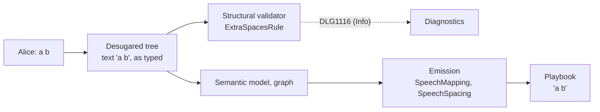

# Speech Whitespace

> [!NOTE]
> Status: **proposed**. The playbook keeps spaces and tabs exactly as typed, so a
> host that draws every space shows spacing no Markdown preview shows. This note
> makes the playbook carry a line the way a preview shows it, with commands and
> tags taken out: spaces typed together become one, a command or a tag takes no
> room, and no space stands before a line's first word or after its last.
> `DLG1116`, an `Info` note, tells the writer where extra spaces collapse.

## Table of contents

- [Goal and scope](#goal-and-scope)
- [Ubiquitous language](#ubiquitous-language)
- [Writer-facing behavior](#writer-facing-behavior)
- [Prior art](#prior-art)
- [Key design decisions](#key-design-decisions)
  - [D1 — The playbook shows a line the way a preview does](#d1--the-playbook-shows-a-line-the-way-a-preview-does)
  - [D2 — Only spaces, tabs, and line breaks collapse](#d2--only-spaces-tabs-and-line-breaks-collapse)
  - [D3 — A command or a tag takes no room, and no space stands outside the words](#d3--a-command-or-a-tag-takes-no-room-and-no-space-stands-outside-the-words)
  - [D4 — Normalized at emission, not in desugar](#d4--normalized-at-emission-not-in-desugar)
  - [D5 — Only what the player reads](#d5--only-what-the-player-reads)
  - [D6 — `DLG1116` is an `Info` note where extra spaces collapse](#d6--dlg1116-is-an-info-note-where-extra-spaces-collapse)
  - [D7 — One note per place, with a fix that keeps what the player reads](#d7--one-note-per-place-with-a-fix-that-keeps-what-the-player-reads)
- [How it works](#how-it-works)
- [Error and boundary cases](#error-and-boundary-cases)
- [Integration](#integration)
- [Functionality checklist](#functionality-checklist)
- [Testing and demonstration](#testing-and-demonstration)
- [Alternatives not chosen](#alternatives-not-chosen)
- [Open questions and deferred work](#open-questions-and-deferred-work)

## Goal and scope

Every place a writer previews a script draws HTML: the VS Code preview, GitHub,
and the report. HTML shows spaces typed together as one. The compiler keeps them
all, and a host that draws its own text, such as a game engine's label or the
terminal player, shows every one:

```text
Alice: a    b      preview "a b"      playbook "a    b"      terminal "a    b"
```

The writer cannot see the difference anywhere they write, and one playbook reads
differently on each host. The guide already rules this out for the spaces after a
speaker's colon, for the same reason. This note extends that reason into a
principle for all of speech: DialogueDown syntax may be visible but unrendered in
a Markdown preview, but it must never be invisible and significant. Spaces typed
together are invisible in the preview and significant in the game.

The compiler also doubles spaces the writer never typed. A command or a tag is
never shown to the player, but the spaces on both sides of it stay:

```text
- Say goodbye `Wave()` and leave      the menu shows "Say goodbye  and leave"
```

A preview draws the command as code, so it shows both spaces with a word between
them. The game draws no word there, so the two spaces meet. The playbook should
read as the preview would with the command taken out.

**In scope:** what the playbook carries for spaces, tabs, and line breaks in what
the player reads (D1–D5), and the note that tells the writer about it (D6–D7).

**Out of scope:** whitespace after a speaker's colon, which is already
insignificant; a quoting construct for speech; speaker names; scene headings and
their anchors; how a host shows a line break; and the values a query is answered
with during a playthrough.

## Ubiquitous language

| Term | Meaning |
| --- | --- |
| **Text** | A text fragment: characters with no markup in them. An entity is decoded into a text of its own, so `a&#32;&#32;b` is four texts: `"a"`, `" "`, `" "`, `"b"`. |
| **Collapsible space** | White space a browser shows as at most one space: a space (U+0020) or a tab (U+0009); a line feed or carriage return in a text, which only an entity such as `&#10;` can write; or a soft line break. |
| **Named space** | Any other space character, usually written as an entity (`&nbsp;`, `&ensp;`, `&emsp;`, `&thinsp;`) or typed directly (U+3000). It never collapses. |
| **Speech list** | One list of speech fragments the playbook carries as words: a line's speech, an option's label, a jump's label, or an image's alt text. Each is normalized on its own. |
| **Unseen fragment** | A command or a tag. It acts or annotates where it stands, and the player never sees it. |
| **Visible piece** | Anything in a speech list that is neither a collapsible space nor an unseen fragment: a character of a text, an image, or a query. |
| **Extra spaces** | Two or more collapsible spaces the writer typed next to each other inside the words, entities included; all but one of them do not show. What `DLG1116` reports. |

## Writer-facing behavior

Spacing in the game matches spacing in a Markdown preview, once the commands and
tags the preview draws are taken out.

| Written | The playbook carries | Why |
| --- | --- | --- |
| `Alice: a    b` | `"a b"` | Spaces typed together show as one. |
| `Alice: a`, a tab, `b` | `"a b"` | A tab is a collapsible space. |
| `Alice: a&#32;&#32;b` | `"a b"` | `&#32;` is an ordinary space. |
| `Alice: a&nbsp;&nbsp; b` | `"a"`, two U+00A0, `" b"` | A named space is kept. |
| `Alice: &nbsp;Hello` | U+00A0, `"Hello"` | A named space is kept, even at the start. |
| `Alice: " Hello"` | `" Hello"`, quote marks included | A quote mark is a visible piece, so the space after it stands between two. |
| ``Alice: Then... `Wave()` I will not argue.`` | `"Then... "`, the command, `"I will not argue."` | A command takes no room, so its two spaces become one. |
| ``- Say goodbye `Wave()` and leave`` | `"Say goodbye "`, the command, `"and leave"` | The same, in an option's label. |
| ``Alice: `Wave()` Hello.`` | the command, `"Hello."` | Before the first word, the space separates nothing. |
| ``Alice: Hi.`Bow()` `Wave()`Bye.`` | `"Hi."`, both commands, `" "`, `"Bye."` | A space alone between two commands moves to the words after them. |
| `Alice: I am #mood=sad fine.` | `"I am "`, the tag, `"fine."` | A tag takes no room. |
| `Alice: Hello. #mood=happy` | `"Hello."`, the tag | After the last word, the space separates nothing. |
| `Alice: Go there => [Go](#market)` | `"Go there"` | The jump becomes an edge, so the space before it follows the last word. |
| `=> [ Back  home ](#start)` | label `"Back home"` | A jump's label is a speech list. |
| `` | alt `"Alice smiling"`, the tag | Alt text is a speech list. |
| `## The  Big  Scene` | anchor `the--big--scene` | A heading is not speech; its anchor matches GitHub's. |

To widen spacing on purpose, name the space. A named space shows in the source,
in the preview, and in every host:

| Entity | Character | Shows as |
| --- | --- | --- |
| `&nbsp;` | U+00A0 no-break space | a space the line never wraps at; repeat it to widen |
| `&ensp;` | U+2002 en space | a wider gap |
| `&emsp;` | U+2003 em space | a wide gap |
| `&thinsp;` | U+2009 thin space | a narrow gap |

Where extra spaces collapse, the compiler says so once for each place (D6):

```markdown
# The Tavern

Alice: a   b
```

```text
scene.dialogue.md(3,9): info DLG1116: Spaces typed together collapse, in a Markdown
preview and in the game alike, so the extra width here does not show. That is
usually what you want, and one space reads the same. To keep the width, write a
non-breaking space for each extra space: `a&nbsp;&nbsp; b`.
```

It offers **Use one space**, the preferred fix, and **Keep the width with
`&nbsp;`** where there is a width to keep (D7).

## Prior art

| System | Spaces typed together | Lesson |
| --- | --- | --- |
| **CommonMark** | Kept in the HTML: `Multiple     spaces` becomes `<p>Multiple     spaces</p>`. Spaces at a line's ends and around a soft break are removed. | Markdown leaves the middle of a line to HTML. The spec notes that browsers collapse spaces in `<code>`, and that a soft break written as a line ending or as a space "will be the same in browsers". |
| **CSS Text 3** | `white-space: normal` collapses spaces, tabs, and segment breaks to one, across the boundaries of inline elements, and removes them at the start and end of a line. U+00A0 and the other space separators do not collapse. | The rule every Markdown preview applies, and the one this note copies. |
| **pandoc** | Reads `a    b` as one inter-word `Space`, so every output, plain text included, has one space. | A Markdown tool whose output is not HTML has to decide what the browser would, and decides the same. |
| **Ink** | The runtime's `CleanOutputWhitespace` "turns all consecutive space and tab runs into single spaces (HTML style)" and trims each line's ends. | A narrative scripting language normalizes in the engine. |
| **Ren'Py** | "Consecutive sequences of whitespace and line breaks are compressed into a single whitespace character, unless a space is preceded by a backslash." | A visual-novel engine collapses too. Its escape, a backslash before a space, is not open to a Markdown language: CommonMark keeps that backslash, so the preview would show it. |

## Key design decisions

### D1 — The playbook shows a line the way a preview does

The preview is where a writer checks a script, so the game agrees with it.
Keeping spaces as typed cannot get there: the report could draw speech with its
spaces preserved, but VS Code and GitHub cannot be changed. Collapsing makes the
preview and every host agree. Only the source differs, as it already does for
`**`, `\#`, and `&nbsp;`.

Spaces typed together are almost always accidents: two spaces after a sentence, a
gap left by a deleted word, text pasted from a word processor. Collapsing does what
a copy editor would. A writer who means the width has a way to write it that shows
in the source, the preview, and every host: a named space.

### D2 — Only spaces, tabs, and line breaks collapse

The collapsible set is the one CSS uses: U+0020, U+0009, and the segment break. A
segment break reaches a script two ways: as a soft line break, and as a line feed
or carriage return an entity writes into a text. Every other space character
(U+00A0, the en, em, and thin spaces, U+3000) is one the writer named on purpose.
CSS keeps it too, so the preview and the game agree on it.

An entity is decoded before this rule applies. `&#32;` is therefore an ordinary
space and collapses, as it does in a browser. `&nbsp;` and the other named spaces
are the way to widen, and the way to start a line with a space.

A collapsible space that is kept becomes a space (U+0020), except a soft line
break, which stays a break: every reading of speech already shows it as one space,
and a host may still use it as a hint.

### D3 — A command or a tag takes no room, and no space stands outside the words

The player never sees a command or a tag, so the spaces on both sides of one stand
between the same two visible pieces. Within a speech list:

1. **Unseen fragments are passed over** when looking for the next visible piece.
2. **Between two visible pieces**, consecutive collapsible spaces become one. The
   first is kept, and the rest are removed.
3. **Before the first visible piece and after the last**, collapsible spaces are
   removed.

Rule 2 is CSS's collapsing across inline boundaries, and rule 3 is its removal of
spaces at the ends of a line.

The first space is the one kept. When the writer puts a space on both sides of a
command, the part of the line before it keeps its space (`"Then... "`) and the
part after begins with a word (`"I will not argue."`), so a host that joins the
parts shows one space, and a host that shows each part alone shows no stray space
at its start. When the only space is written after the command, as in
``Hi`Wave()` there``, that space is the one kept, and the part after begins with it.

A kept space with nothing but commands and tags after it until the next visible
piece moves past them to just before that piece. A runner speaks the words
between two commands as a part of the line and skips a part holding only a space,
so in ``Hi.`Bow()` `Wave()`Bye.`` a space left between the commands would run
`"Hi."` and `"Bye."` together for a host that joins the parts. Moved, the part
after the commands begins with it, as in ``Hi`Wave()` there``.

A styled text and a link's label belong to the list around them, as an inline
element belongs to its line in CSS. An image is a visible piece, and its alt text
is a speech list of its own, as an attribute is not part of the line in HTML. A
query is a visible piece; what it is answered with is not normalized.

### D4 — Normalized at emission, not in desugar

The Dialogue AST holds the writer's exact text, and every span in it addresses
real source. Rewriting text in desugar would leave a text's span covering
characters its content no longer holds, so an offset within the text would stop
being an offset within the source. `DLG1116` locates spacing exactly that way, and
the evidence it reports would be gone. The playbook carries no spans, so emission
is where text can change.

`SpeechMapping` already writes every speech list the playbook carries: a line's
speech for `NodeMapping`, and an option's or a jump's label for `EdgeMapping`.
Normalizing there covers all of them, and the runner, the report's Playbook tab,
and every host receive the same text.

The stages before emission keep the text as typed: the report's AST tabs, its
semantic model, and its Graph tab, which all read the compiler's own fragments.
That is the point of showing each stage, and the Playbook tab beside them shows
the text as it plays. The two readings of a fragment as plain text still agree,
because each fragment maps as before; it is a whole list that can differ between
the stages, by this design.

### D5 — Only what the player reads

The rule covers speech lists and nothing else:

- **Speaker names** come from the speaker prefix or `dialogue.toml` as identifiers
  or quoted strings, not prose.
- **Scene headings** never reach the playbook as text; only their anchors do. An
  anchor keeps GitHub's one hyphen per space (`the--big--scene`), so a link that
  works in a GitHub preview works in the game.
- **Whitespace between a control line's effects** is not emitted at all.

### D6 — `DLG1116` is an `Info` note where extra spaces collapse

With D1 in place the preview and the game agree, so nothing in the script is
suspect, and a warning would be wrong. What remains is that the compiler changed
what the writer typed. A writer who meant the width should hear it once, with the
remedy. This follows the [ignored Markdown](../diagnostics/Ignored%20Markdown%20Diagnostic.md)
note: a neutral note, so a change is never a surprise. `Info` never affects
`HasErrors` or an exit code.

The structural validator reports it over the desugared tree, where the typed text
and its span are still intact. Emission cannot report it: it runs on a finished
compile and has no diagnostics sink.

The rule visits each text once. It reads a line's speech, with the styled text,
link labels, and alt text inside it, and a jump's label. An option's label needs no
visit of its own: it is the same fragments as its line's speech, or its jump's
label. The rule skips the text between a control line's effects, which is never
emitted. Adjacent texts are read together, so extra spaces split across entities
are found.

It reports extra spaces only. Every other change D3 makes comes from one space
the writer typed, or none, and is not reported:

- a single space merged with another across a command, a tag, the edge of
  emphasis or a link, or a soft line break;
- a single space removed before the first visible piece or after the last, such as
  the padding in `[ Go ](#x)`;
- a single tab or encoded line break, which becomes a space.

The code is `DLG1116`, in the syntax range. The category is `Syntax`,
beside `DLG1114`, because the note is about the script's surface.

### D7 — One note per place, with a fix that keeps what the player reads

Each place with extra spaces gets its own note at its span, as each ignored
construct gets its own `DLG1114`. It comes with up to two fixes:

- **Use one space** (preferred) replaces the spacing with one space. With D1 in
  place, what the player reads is the same either way, so this fix is safe to
  apply in bulk: `ddown compile --fix` or the editor's Fix All clears a script
  written with two spaces after every sentence in one step, and the notes stop.
- **Keep the width with `&nbsp;`** replaces every collapsible space but the last
  with `&nbsp;`, so the line shows the width the source did and can still wrap at
  the last space: `a   b` becomes `a&nbsp;&nbsp; b`. It is offered only where
  visible pieces stand on both sides of the spacing. Before the first or after the
  last, the spacing shows as nothing, and there is no width to keep.

The preferred fix can change one fragment without changing what the player reads.
Entity spaces before a line ending (`end&#32;&#32;`) are kept by Markdown, which
strips only literal trailing spaces; after the fix, the one literal space is
stripped, and the line ending becomes a soft line break. Both read as one space.

Two spaces after a sentence get no exemption. It would be a hidden rule that holds
for some languages' punctuation and not others, and the bulk fix answers the habit
directly.

## How it works



`SpeechSpacing`, in `DialogueDown.Emission`, takes one mapped speech list and
returns it normalized. `SpeechMapping` calls it once for each list it is handed by
`NodeMapping` or `EdgeMapping`, and once for each image's alt text. The styled
texts and link labels inside a list are part of that list, not lists of their own.

It reads the list in order, descending into styled text and link labels, in three
passes:

1. **Forward.** Remember whether the last thing kept was a collapsible space,
   starting as though one was, and pass over unseen fragments without changing
   that. Remove each collapsible space that follows a kept one. A kept space, tab,
   line feed, or carriage return becomes a space; a kept soft line break stays.
2. **Backward.** Remove each collapsible space with no visible piece after it.
3. **Placing.** Move a space kept right after an unseen fragment past any more
   unseen fragments, to just before the next visible piece.

A text left empty is omitted, and so is a soft line break that is removed. Every
other fragment, and every character that is not a collapsible space, stays where
it was. A link or an image whose label or alt text is left empty stays, with an
empty label.

`ExtraSpacesRule` is a structural-validator rule beside `CommandInLabelRule`. It
visits each text once as D6 describes, reads each sequence of adjacent texts as
one string, and reports each place where two or more collapsible spaces stand
together. To decide whether to offer the second fix of D7, it looks for a visible
piece on each side within the same list, passing over commands and tags.

## Error and boundary cases

| Case | Behavior |
| --- | --- |
| Extra spaces split across texts, as in `a&#32;&#32;b` or `a &#32;b` | Collapsed, since the rule reads the whole list. One `DLG1116` spanning all of it. |
| An encoded line break between spaces, as in `x &#10; y` | Collapsed to `"x y"`; reported. |
| Spaces around several commands or tags in a row | One space kept between the visible pieces on either side. |
| A list holding only unseen fragments and spaces | Every space removed; the commands and tags stay. |
| An option whose label is only spaces, as `- &#32;` | Offered with an empty label, as an option holding only a command is already. |
| A link or an image whose label is only spaces, as `[ ](#s)` | The link or image stays, with an empty label. |
| A text emptied by the rule | Omitted. |
| A query or an image between spaces | Kept: each is a visible piece. A query's answer is not normalized. |
| A space written only after a command, as ``Hi`Wave()` there`` | Kept; the part after the command begins with it. |
| A space alone between two commands, as ``Hi.`Bow()` `Wave()`Bye.`` | Moved past the commands to the words after them, so no part of the line holds only a space. |
| Extra spaces inside emphasis or a link's label | Collapsed with the list around it; reported. |
| Extra spaces in alt text | Collapsed within the alt text; reported. |
| A soft line break after a command, as ``a `Wave()` `` and `b` on the next line | The break follows a kept space and is removed: `"a "`, the command, `"b"`. |
| Extra spaces before a trailing command, as ``Hello  `Wave()` `` | Removed after the last word; reported, with only the preferred fix. |
| An option `- a  b` | One `DLG1116`: the label and the line's speech are the same fragments. |
| Extra spaces before a dangling arrow, as `x  => y` | `DLG1116` and `DLG1113` each carry a fix; `--fix` applies both. |
| U+00A0 beside a space, as in `a&nbsp; b` | Both kept: U+00A0 does not collapse. |
| A named space before the first word or after the last | Kept. |
| A named space alone between two commands | Kept, and the runner speaks it as a part of the line (see [Integration](#integration)). |
| Spaces between a control line's effects | Not emitted; not reported. |
| Whitespace after a speaker's colon | Already removed by the transpiler; unchanged. |
| A scene heading with extra spaces | Not speech: the anchor is unchanged, and nothing is reported. |
| A playbook compiled before this rule | Loads and plays as written. The format is unchanged, and the runtime does not normalize. |

## Integration

The code changed with the implementation:

- **Emission.** `SpeechSpacing` is new; `SpeechMapping` calls it as
  [How it works](#how-it-works) describes. Its callers do not change.
- **Validation.** `ExtraSpacesRule` joins `StructuralValidatorFactory`'s default
  set.
- **Catalog.** `DLG1116`, titled "Spaces typed together collapse", `Syntax`,
  `Info`, with the message in [Writer-facing behavior](#writer-facing-behavior).
- **Runtime.** `SpeechSegment.SaysSomething` counts a named space as something
  said. It now treats any white space as nothing, so a part holding only `&nbsp;`
  would never be spoken; it narrows to collapsible spaces and line breaks.
- **Fixes.** Fix mode and the editor need no change: both apply a diagnostic's
  preferred fix whatever its severity. `DLG1116` is the first `Info` note with a
  fix, and the first producer to offer an alternative, so the plain compile's
  `N fixable with --fix` hint counts notes too.
- **Conformance corpus.** A playable playbook must equal what its source compiles
  to, and each fixture pins the strings it expects. Six cases change:
  `a-command-mid-line` continues with `"I will not argue."`;
  `a-command-opening-a-line` continues with `"Hello."`; `a-command-in-a-label`
  offers and continues with `"and leave"`; `a-command-ending-a-line` and
  `a-failed-command-in-a-line` say `"Hello."`; and `a-query-after-a-command`
  continues with `"Now it is 15."`. New playable cases pin spaces typed together
  arriving as one, a named space between two commands being said, and a space
  alone between two commands moving to the words after them.
- **Emission goldens.** All four change (`gallery`, `highrise-fire`, `rpg-quest`,
  `visual-novel`): nearly every line that ends in a command or a tag loses the
  space before it.

The documentation changed with the implementation:

- **Error-code reference.** A `DiagnosticDocs` entry for `DLG1116` with a triggering
  example and both fixes, compiled by the docs tests, and the regenerated
  `docs/guide/error-codes.md`.
- **The writer's guide to speakers and lines.** A section on spacing: spaces typed
  together show as one, the named spaces above, and a command or a tag takes no
  room. The colon section's reason names HTML, not Markdown, as what collapses
  spaces. A named space is shown as the way to begin speech with a space:
  `Alice: &nbsp;Hello, Bob!`.
- **[Diagnostics and Validation](../diagnostics/Diagnostics%20and%20Validation.md).**
  `DLG1116` in the stage table and a row in the validator's rule table.
- **[Speaking a Line](../runtime/Speaking%20a%20Line.md).** Its scope line links
  here. Its examples and sequence diagrams show the new strings, and its
  definition of saying something follows the runtime change above. The part about
  a single space between two commands becomes a rule for playbooks the compiler no
  longer writes, such as hand-built or older ones.
- **[Offering a Choice](../runtime/Offering%20a%20Choice.md).** O4 links here, and
  no longer says a label whose command came first starts with a space.
- **[Speech as Plain Text](../runtime/Speech%20as%20Plain%20Text.md).** Its
  agreement table says the readings agree fragment by fragment, and that a whole
  list read before emission keeps its extra spaces (D4).
- **[Compile CLI — Fix Mode](../cli/Compile%20CLI%20-%20Fix%20Mode.md).** Its claim
  that `DLG1113` is the only producer, so overlap cannot occur, names `DLG1116`.

## Functionality checklist

- [ ] Spaces, tabs, and encoded line breaks typed together in a line's speech, an
      option's label, a jump's label, and alt text reach the playbook as one space.
- [ ] Extra spaces split across texts by entities collapse the same way.
- [ ] Named spaces reach the playbook unchanged, and the runner speaks a part that
      holds only one.
- [ ] A command or a tag takes no room, and no collapsible space stands before the
      first visible piece or after the last.
- [ ] A text emptied by the rule, and a removed soft line break, are omitted.
- [ ] `DLG1116` reports each place with extra spaces once, at its span, as
      `Info`, with the preferred fix and, between visible pieces, the alternative.
- [ ] Merges beside commands, tags, and boundaries, the ends of a list, a single
      tab, a control line's effects, and headings report nothing.
- [ ] The six changed corpus cases, the new ones, and the four goldens pass.
- [ ] The properties in [Property tests](#property-tests) hold.
- [ ] `DLG1116` has a compiled example in the error-code reference.
- [ ] The writer's guide explains spacing and the named spaces.

## Testing and demonstration

### Example tests

| Unit | What it pins |
| --- | --- |
| `SpeechSpacing` | Each row of [Writer-facing behavior](#writer-facing-behavior) and [Error and boundary cases](#error-and-boundary-cases) that concerns the playbook, built from fragments directly. |
| `SpeechMapping` and `EdgeMapping` | A line's speech, an option's label, a jump's label, and alt text each arrive normalized; a styled text is normalized with its line, not alone. |
| `SpeechSegment` | A part holding only a named space says something; a part holding only collapsible spaces and line breaks does not. |
| `ExtraSpacesRule` | It reports extra spaces in speech, emphasis, a link's label, alt text, and a jump's label, at the right span, including spacing split across entity texts, and reports an option's label once. It offers the alternative fix only between visible pieces. It stays silent for single spaces, a single tab, named spaces, a control line's effects, and a heading. |
| Compilation | A script with extra spaces compiles, reports `DLG1116`, and emits one space. |
| CLI fix | `--fix` on a script with extra spaces rewrites it, and the recompile reports no `DLG1116`. On `x  => y` it applies both the `DLG1116` and the `DLG1113` fix. |

### Property tests

These use CsCheck, like `CompilerPropertyTests`, over generated speech lists that mix
texts with spaces, tabs, encoded line breaks, and named spaces, styled text, links,
images, queries, commands, tags, and soft line breaks.

| Property | The law |
| --- | --- |
| **Normalizing twice changes nothing** | `SpeechSpacing` applied to its own output returns it unchanged. |
| **The three rules hold** | In the output, passing over unseen fragments, no collapsible space follows another, and none stands before the first visible piece or after the last. |
| **Only collapsible spaces change** | Removing every collapsible space from the input and the output leaves the same characters and the same other fragments, in the same order. |
| **The preferred fix keeps what the player reads** | A generated script, and the same script after every `DLG1116` preferred fix, compile to playbooks whose speech lists read the same through `SpeechText.Of` and hold the same commands, tags, images, and queries in the same order. |

### Shown to writers

| Where | What the writer sees |
| --- | --- |
| The writer's guide to speakers and lines | Spaces typed together show as one, and the named spaces that widen. |
| The error-code reference, `DLG1116` | Spacing that collapses, and its two fixes. The docs tests compile all three: the triggering example reports `DLG1116`, and neither fix does. |

## Alternatives not chosen

- **Warn and keep the spaces.** The playbook would still read differently on each
  host, which is the problem; a warning would only describe it.
- **Leave it to hosts.** Every host would carry its own copy of the rule, and the
  merge beside a command needs the whole line, which a host shown a line in parts
  never holds at once.
- **Collapse each text on its own.** It misses spacing split across entity texts,
  and the doubled space a command or a tag leaves.
- **Normalize in desugar.** Spans would stop matching their texts (D4).
- **Keep spaces before the first word and after the last.** A label after a
  leading command, and speech before a jump, would begin or end with a space no
  preview shows.
- **Normalize the stages before emission too.** The report's stage tabs exist to
  show what each stage holds, and the typed text is what the desugared tree holds.
- **A `Warning`.** Once the preview and the game agree, nothing is suspect (D6).
- **One note per line or per file.** It would lose the exact span and the fix for
  each place; the bulk fix already handles volume.
- **Exempt two spaces after a sentence.** A hidden rule, tied to some languages'
  punctuation (D7).
- **A backslash before a space as the escape.** CommonMark keeps that backslash, so
  the preview would show it and the game would not.

## Open questions and deferred work

- **Turning the note off.** No setting silences `DLG1116` yet, as none silences
  any other diagnostic. A setting that disables a diagnostic by code, from the
  command line or `dialogue.toml`, is planned separately. Until then, a writer who
  keeps typing two spaces after a sentence sees a note for each until they run the
  bulk fix.
- **Quoting speech.** A quote mark is a visible piece: the preview draws it, and
  today it reaches the playbook as text. `Alice: " Hello"` therefore keeps its
  space, which stands between the mark and the word. A quoting construct that
  removes the marks so that the host decides how to show them must remove them
  after this rule, not before. Then `Alice: " Hello"` and `Alice: "   Hello"`
  both begin with one space. Removed first, the space would stand before the first
  visible piece, and rule 3 of D3 would remove it.
- **A query's answer.** A query answered with spaces, or with nothing, can leave
  spacing during a playthrough. Normalizing filled speech belongs to the runtime
  and is not designed here.
