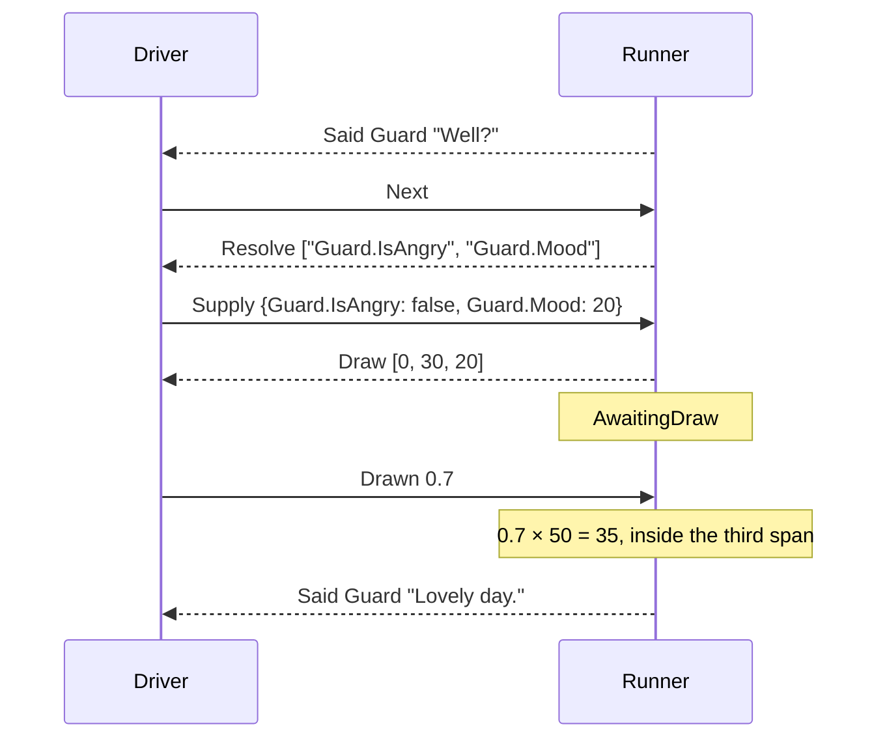

# Drawing a random option

> [!NOTE]
> Status: **implemented**. The pass that lets the runner play a random
> choice: it asks the world what decides the odds, asks the host for a draw, and
> follows the random option the draw lands on. The runner draws at a random choice
> of number, auto, and key weights, asks the world about its random options'
> conditions and key weights on arrival, and leaves the excluded random options
> out. It settles where the runner's randomness
> comes from ([R1](#r1--the-host-supplies-the-draw-the-runner-turns-it-into-a-random-option)),
> plays the weights the [random choice](../language/Random%20Choice.md) note
> defines, and reuses [asking the world](./Asking%20the%20World.md) and the shape of
> [offering a choice](./Offering%20a%20Choice.md).

## Table of contents

- [Goal and scope](#goal-and-scope)
- [Vocabulary](#vocabulary)
- [Functionality checklist](#functionality-checklist)
- [How a random choice is played](#how-a-random-choice-is-played)
- [Interfaces and abstractions](#interfaces-and-abstractions)
- [Key design decisions](#key-design-decisions)
- [Error and boundary cases](#error-and-boundary-cases)
- [Integration](#integration)
- [Testability](#testability)

## Goal and scope

A writer lets the engine pick one of several random options with a weighted list:

```markdown
The guard looks up.

- `Guard.IsAngry?` `50%` Guard: Halt!
- `30%` Guard: Move along.
- `Guard.Mood%` Guard: Lovely day.
```

This pass plays a `random-choice` node: the runner asks the world what decides the
odds, works out each random option's share, asks the host for a draw, and follows
the random option the draw lands on. The player sees no menu.

The pass has three milestones:

| Milestone | What it delivers |
| --- | --- |
| **M1 — static weights** | Number and auto weights resolved to shares; the `Draw` request, the `Drawn` command, and the wait between them; the draw mapped onto the shares; the reader refuses an invalid number weight; the compiler reports a random choice whose only random option weighs `0%` |
| **M2 — guarded random options** | A random option's condition asked on arrival; an excluded random option left out before the shares are worked out; a random choice with nothing left to draw walked past by its fall-through, or refused as `leads-nowhere` without one |
| **M3 — key weights** | A key weight asked on arrival and answered with a number; a number joins the answers; a key weight answered with an invalid number refused; the compiler gives a random choice a fall-through whenever it may have nothing to draw |

In scope:

- playing a `random-choice` node and the `random-option` edges out of it;
- the source of randomness, and how a draw picks a random option;
- reading the world once for a random choice: its conditions and its key weights;
- a number among the world's answers;
- refusals for a draw out of range and an invalid number for a weight;
- a reader rule for a number weight;
- the compiler's report of a random choice whose only random option weighs `0%`;
- when the compiler gives a random choice a fall-through;
- a `drawn` send and a `draw` matcher in the harness, and corpus cases;
- random choices in `PlaybookGen`, so the walk property draws them.

Out of scope: the drift warning the language defines for a total far from 100,
because the runner has no channel for warnings yet; the policy a driver follows for
a key nobody bound; saves; and a weighted menu the player sees, which the
language rules out.

## Vocabulary

| Term | Meaning |
| --- | --- |
| **Random choice** | A `random-choice` node: random options the engine picks among by weight, with no menu |
| **Random option** | One `random-option` edge: the node it leads to, a weight, and an optional condition. A random choice's `succession`, when it has one, is not a random option |
| **Weight** | What the writer wrote: a number (`` `30%` ``), an auto weight (`` `%` ``), or a key weight (`` `Guard.Mood%` ``) |
| **Share** | What a random option's weight comes to: its number, the world's answer for a key weight, or, for an auto weight, an equal part of what the random options in play leave of 100. An excluded random option's share is zero |
| **Excluded** | A random option whose condition the world withholds. Every other random option is **in play** |
| **Drawable** | A random option whose share is above zero, so a draw can land on it |
| **Total** | The sum of every random option's share |
| **Draw** | A number from `0` to `1` the host supplies, and the `Draw` request that asks for it |
| **Drawn random option** | The random option whose span of the total the draw lands in |

## Functionality checklist

M1:

- [x] A random choice, once arrived at, sends `Draw` with every random option's
      share, in the order written, and waits for `Drawn`.
- [x] Number and auto weights resolve to shares as the language defines: an auto
      weight takes an equal part of what the numbers leave of 100.
- [x] A draw lands on the random option whose span holds it, the spans laid end to
      end in the order written; the run arrives where that random option leads.
- [x] A draw below `0`, above `1`, or not a number is refused as `invalid-draw`, and
      the run keeps waiting for another.
- [x] `Drawn` anywhere else, and `Next`, `Done`, `Failed`, `Supply`, or `Choose`
      while a draw is awaited, is refused as misplaced.
- [x] The reader refuses a number weight that is negative or not finite, and a
      random choice whose number weights sum to more than a double can hold.
- [x] The compiler reports a random choice whose only random option weighs `0%` with
      `DLG2010`, as it reports any zero total, and not with `DLG3004`, which says the
      random option is always taken.

M2:

- [x] A random choice's conditions are asked on arrival, in one request.
- [x] An excluded random option keeps no share, and the random options in play share
      the draw as if it were not written: an auto weight takes an equal part of what
      their numbers leave of 100.
- [x] A random choice with nothing drawable is walked past by its fall-through, and
      one with no fall-through is refused as `leads-nowhere`.

M3:

- [x] A key weight is asked on arrival with the conditions, and answered with a
      number.
- [x] A key weight in play answered with a number that is negative or not finite,
      or answers whose shares are too large to add up, are refused as
      `invalid-weight`, and the run keeps waiting where it asked. An excluded random
      option's key weight is asked, but its number is neither checked nor counted.
- [x] One key used as a condition and as a key weight is refused as
      `key-needed-both-ways` before anything is asked, as it is for any node.
- [x] The compiler gives a random choice a fall-through unless an unguarded random
      option has a number above zero or an auto weight, so a compiled random choice
      with nothing drawable is always walked past.

## How a random choice is played

A random choice is its own step, after the node before it. With the script above:



The angry guard's random option is excluded, so its share is zero. Laid end to end
in the order written, the shares take the spans `[0, 0)`, `[0, 30)`, and `[30, 50)`
of the total of `50`. A draw of `0.7` stands at `35`, inside the third span. An empty
span is never landed on.

After the draw, the run arrives where the random option leads, as it arrives
anywhere: asking what that node needs, walking past a jump, or saying a line.

## Interfaces and abstractions

| Type | Responsibility | Collaborators |
| --- | --- | --- |
| `Draw(shares)` | A request answered by `Drawn`: every random option's share in the order written, and a draw wanted from `0` to `1` | `Request` |
| `Drawn(value)` | A command: the draw the host made | `Command` |
| `AwaitingDraw(node, shares)` | Waiting for the host at a random choice, and the shares the open `Draw` named | `Situation` |
| `NumberAnswer(value)` | An answer: a number, as a key weight needs | `Answer` |
| `NodeQuestions` | For a random choice, its conditions as truths and its key weights as numbers; the same whether read for the whole node or from its start | `Arrival` |
| `DrawingWeight` | A weight ready for the draw, `Number` or `Auto`, and the arithmetic over them: `Shares` and `Total`. The one definition the compiler and the runner share | The compiler's weight checks, `WeightShares` |
| `WeightShares` | The playbook's adapter: turns a random choice's random options into drawing weights, an excluded one into a number of zero and a key weight in play into the number the world answered. It takes the answers even when no random option has a key weight | `IRandomOptionArbiter`, `IKeyWeightAnswers`, `RandomChoiceShares` |
| `IRandomOptionArbiter` | Decides which random options are excluded: yes or no for each, nothing more | `WeightShares` |
| `IKeyWeightAnswers` | Gives each key weight the number the world answered for its key | `WeightShares` |
| `GuardArbiter` | The runner's arbiter: excludes a random option whose condition the world withholds | `RandomChoiceShares` |
| `AnsweredKeyWeights` | The runner's answers for key weights: the numbers in the world's supply | `RandomChoiceShares` |
| `RandomChoiceShares` | Works out a random choice's shares with the world's answers, and whether any is drawable, once the world has answered any guard or key weight. `WithoutExcluded` gives the random options in play | `WeightShares`, `GuardArbiter`, `AnsweredKeyWeights`, `Playing`, `Arrival`, `Drawing`, `KeyWeightCheck` |
| `KeyWeightCheck` | Refuses a supply that answers a key weight in play with an invalid number, or whose shares in play are too large to add up. An excluded random option's key weight is not checked | `RandomChoiceShares`, `Arrival` |
| `Drawing` | Sends `Draw` with the shares worked out; takes `Drawn`, finds the random option it lands on, and arrives where it leads. It reads only the shares, never the weights | `Playing`, `Runner` |
| `Arrival` | Walks past a random choice with nothing drawable, as it walks past a menu with nothing available | `RandomChoiceShares` |
| `DrawnReader`, `DrawMatcher` | Read a fixture's `drawn` send, and hold a `Draw` to its `draw` expectation | The harness |

## Key design decisions

### R1 — The host supplies the draw; the runner turns it into a random option

The runner is a pure function of state and command, so randomness has to come from
outside it. There were four places to put it:

| Option | Why not, or why |
| --- | --- |
| A generator the runner owns, seeded at `Start` | Every runtime would have to match one specified generator bit for bit, including 64-bit integer arithmetic that JavaScript and GDScript do not do natively. A fixture would read as "seed 42 lands on the second random option", which explains nothing, and a save would carry the generator's state |
| The host picks the random option | The simplest runner, but "by weight" becomes every host's promise, and the corpus cannot hold a host to it |
| The draw as a key in `Resolve`, answered in `Supply` | No new request, but a draw is not a read of the world. A driver may serve answers from a cache, as [A2](./Asking%20the%20World.md#a2--the-runner-does-not-remember-an-answer) allows, and would then draw the same number every time; and every world would share a reserved key name |
| **The host supplies a number, and the runner maps it to a random option** | Chosen. The weights stay the runner's, where the corpus checks them; randomness, seeding, and saving stay the host's |

Asking costs one more request and answer per random choice. In return the runner
stays pure, a replay of the commands replays every draw, and a fixture reads as
plainly as "a draw of 0.7 lands on the third random option".

`Draw` names every random option's share, so a host can show the odds, and a
debugger that wants one random option sends a draw inside its span. The corpus
states the shares directly, which pins the arithmetic of
[R5](#r5--an-excluded-random-option-is-left-out-before-the-shares-are-worked-out)
and [R9](#r9--the-compiler-and-the-runner-share-one-definition-of-a-share).

### R2 — A draw lands on the random option whose span holds it

The draw is a number from `0` to `1`, both included, so that a host can pass on any
common random source: `Math.random()` and `Random.NextDouble()` stop short of `1`,
while Godot's random float includes it. The runner multiplies the draw by the total
and lays the shares end to end in the order written:

```text
point = draw × total
sum = 0
for each random option, in the order written:
    sum = sum + share
    if point < sum: take this random option
take the last drawable random option
```

Each span is half-open, so a draw at the exact end of one span belongs to the next
random option. The last line is reached only by a draw of `1`, which stands at the
total and lands on the last drawable random option.

The arithmetic is IEEE 754 binary64, which every runtime has: the shares summed one
at a time from the first, never by a library sum that may reorder them, and an auto
weight's share computed as `max(0, 100 − numbers) ÷ autos` over the random options
in play. Two runtimes then reach the same random option for the same draw. A boundary can still fall a hair either side of
its decimal value, `0.29 × 100` being `28.999999999999996`, so corpus cases put their
boundaries at draws a double holds exactly, such as `0.5` and `0.25`.

### R3 — What decides the draw is read once, on arrival

A random choice's conditions and its key weights are asked before the draw, in
one `Resolve`, as the **before playing** moment of
[A1](./Asking%20the%20World.md#a1--one-ask-per-moment). A random choice performs
nothing, so nothing changes between reading the world and drawing, for the same
reason a menu reads its options' conditions on arrival
([O5](./Offering%20a%20Choice.md#o5--what-decides-a-menu-is-read-once-on-arrival)).
A random choice has no **before leaving** moment.

The request names its keys as every node's does: truths, then words, then numbers. A
random choice has no words, so its conditions come first and its key weights after
them, each in the order written and each key once.

### R4 — The wait keeps the shares

`AwaitingDraw` carries the shares its `Draw` named, so `Drawn` is mapped without
asking the world again. This is
[O6](./Offering%20a%20Choice.md#o6--the-wait-keeps-what-was-offered) for a random
choice: the wait holds what its open request was made against, not the answers that
produced it.

Where each random option leads is read from the node when the draw arrives. A wait
whose node is not a random choice, whose shares do not match the node's random
options, or whose shares leave nothing drawable refuses `Drawn` as misplaced. A run restored at a draw arrives
at the random choice afresh, reading the world as it is then, as a run restored at a
menu does; saves own the restore.

### R5 — An excluded random option is left out before the shares are worked out

The random options in play share the draw as if the excluded ones were not written:
an auto weight takes an equal part of what the numbers in play leave of 100, and an
excluded random option's share is zero. Take this random choice:

```markdown
- `Guard.IsAngry?` `50%` Guard: Halt!
- `30%` Guard: Move along.
- `%` Guard: Lovely day.
```

An angry guard draws at `50 : 30 : 20`. A calm guard draws at `0 : 30 : 70`, because
the auto weight takes everything `30%` leaves.

This keeps the promise the [guide](../../../guide/structure-and-flow.md#random-choices)
makes for an auto weight: pin the odds that matter and let the rest divide evenly.
`30%` stays 30% whenever an auto weight is in play to take the rest. When none is,
the numbers in play re-normalize, as the language says: a calm guard with `50%`,
`30%`, and `20%` written draws at `30 : 20`, which is 60% and 40%. An excluded
random option is treated as a false condition is treated everywhere else, as if it
were not there.

The alternative was to work out every share from the weights as written and only
then set the excluded shares to zero. That keeps the ratio between two random options
in play fixed whatever a third one's condition says, but a random option out of play
would still take its part of 100 from the auto weights. The calm guard above would draw at
`30 : 20`, and with `60%` and `40%` written beside the auto weight, "Lovely day"
could never be said at all.

An excluded random option's key weight is still asked, because the conditions and
the key weights come back in one answer, but its number is neither checked nor
counted. A game may calculate a key weight's number from other values, and the result
can be negative while a guard excludes its random option:

```markdown
- `Hero.CanAttack?` `Hit.Chance%` Hero: Strike!
- `%` Hero: Back away.
```

Told that the hero cannot attack and that `Hit.Chance` is `-10`, the run draws, and
only "Back away." can be drawn. A key read by an excluded random option and by one in
play is checked, because the one in play counts it.

### R6 — A random choice with nothing drawable is walked past

A random option can be drawn only when its share is above zero. When none can be,
because the world withholds every random option or because the random options in play
all have a share of zero, the walk takes the random choice's fall-through, as it takes
a menu with nothing available
([O9](./Offering%20a%20Choice.md#o9--a-menu-with-nothing-available-is-walked-past)),
and asks for no draw. Walking past means the run never stands at a node it could only
leave by its fall-through, so a `Next` after a refusal cannot quietly take a way out
the refusal ruled out.

The compiler gives a random choice a fall-through unless an unguarded random option
has a number above zero or an auto weight. Either makes sure something is drawable:
the number is its own share, and beside an auto weight the shares in play add up to at
least 100. Any other random option can be left with no share, since a guard can read
false and a key weight can be answered `0`:

```markdown
- `Ada.Affection%` Ada: Walk with me?
- `Bo.Affection%` Bo: Walk with me?

Evening falls.
```

With both affections still `0`, nothing can be drawn, and the run goes on to "Evening
falls." So in a compiled playbook, a random choice with nothing drawable is always
walked past, whichever of its random options are guarded.

A writer who wants a line of its own for when every key weight is zero writes it as a
random option, which is what an auto weight is for:

```markdown
- `Ada.Affection%` Ada: Walk with me?
- `Bo.Affection%` Bo: Walk with me?
- `%` Nobody speaks up.
```

With both affections at `0`, the auto weight takes all of 100; once they reach 100
between them, it takes nothing. This random choice gets no fall-through, since the auto
weight makes sure something is drawable.

Only a playbook built without the compiler can have a random choice with nothing
drawable and no fall-through. The runner refuses it as `leads-nowhere`, and the run
stands at it, as at any node that leads nowhere.

The compiler reports a zero total for static weights as `DLG2010`, an error, and that
includes a random choice whose only random option is `0%`. A single random option is
always taken only while its share is above zero, so this one never is. `DLG3004`, which
says a single random option is always taken, stays quiet for it. A single random option
of any other weight is still spared the warning for a total far from 100.

### R7 — A random choice always draws while it stands

A random choice the run stands at always asks for a draw, even when one random
option holds the whole total. Every random choice the host meets then talks to it the
same way. The language already warns about a random choice with a single random
option, so this case is rare in a compiled playbook.

### R8 — A key weight is answered with a number

`NumberAnswer(value)` is the answer a key weight needs, the third member of the
closed union [A3](./Asking%20the%20World.md#a3--an-answer-is-a-closed-union)
defines. It is a JSON number on the wire, as `BooleanAnswer` is `true` or `false`
and `TextAnswer` is a string, so one `supply` can answer a condition, a query, and a
key weight. A number for a key that needed a truth or words, or the reverse, is
refused as `wrong-answer-kind`.

A number is valid as a weight when it is finite and not negative, as for a written
weight, and the shares must add up to a finite total. An answer that breaks either is
the right kind with an invalid number, so it is refused as `invalid-weight` and the
run keeps waiting where it asked, so the driver can send a corrected supply. The
answers are first checked as they are at any node, for a key left out, a key not
asked, or the wrong kind, and only then for their numbers. Only the key weights of random
options in play are checked, as
[R5](#r5--an-excluded-random-option-is-left-out-before-the-shares-are-worked-out)
explains.

A key needed as two kinds at once, a condition and a key weight on one random choice,
is refused as `key-needed-both-ways` before anything is asked, as it is for a guard
and a query on one line.

The run waits for the answer holding nothing but the keys it asked, so a driver may
take as long as it needs: ask a person, or look the key up elsewhere. A driver that
still cannot answer a key weight, because nothing is bound to it and nothing repairs
it, has the two moves the protocol already gives it. It can answer `0`, which keeps
the random option from being drawn and leaves its part of 100 to the auto weights, or
stop the run, as it may after a
[failed effect](./Runner.md#d15--a-failed-effect-holds-the-run).
Which one it makes is the driver's policy; the runner has no answer meaning unbound.

### R9 — The compiler and the runner share one definition of a share

The compiler works out static shares to warn about their total, and the runner works
them out to draw. The language's
[D9](../language/Random%20Choice.md#d9--weight-normalization-is-an-injectable-strategy)
wants one definition of that arithmetic, and the runtime may depend only on the
playbook library, so the arithmetic lives there, on `DrawingWeight`.

A drawing weight is a weight ready for the draw: a number, or an auto weight. There
is none for a key, because a key has no number until the world answers it, so an
unanswered key cannot reach the arithmetic. `DrawingWeight.Shares` gives each number
its own share and each auto weight an equal part of what the numbers leave of 100,
and `DrawingWeight.Total` adds the shares up in the order written, as R2 requires.

Each side turns its own weights into drawing weights, so neither builds the other's
types to reach the arithmetic:

| Side | A number | An auto weight | A key weight | An excluded random option |
| --- | --- | --- | --- | --- |
| Compiler | `Number` | `Auto` | Refused: it has no compile-time value | Not met: a guarded random choice is not checked |
| Runner | `Number` | `Auto` | `Number` holding the answer, once R8's checks pass | `Number(0)`, which adds nothing to the numbers and takes no part of the rest, as R5 requires |

The runner reaches the arithmetic through `WeightShares`, the playbook library's
adapter for a playbook's own weights. It takes the random options and an
`IRandomOptionArbiter` that says which are excluded, and gives an excluded one
`Number(0)` without reading its weight. The library knows how a share is worked out,
and the runner knows what the world said, so the judging stays with the runner: its
`GuardArbiter` excludes a random option whose condition the world withholds. The
arbiter answers only yes or no, so R5's arithmetic stays in one place, and a test
can exclude whichever random options it likes. `WeightShares` also takes an
`IKeyWeightAnswers` that gives each key weight in play the number the world answered,
as `SpeechTemplate.Fill` takes an answer for each query; the runner's
`AnsweredKeyWeights` reads those numbers from the supply.

Normalizing shares into probabilities stays in the compiler, behind
`IWeightNormalization`, with its uniform recovery from a zero total that keeps later
checks from dividing by zero. The runner never normalizes: R2 draws against the
total directly.

### R10 — The reader refuses an invalid number weight

The schema lets a number weight be any JSON number, and only the compiler rejects a
negative one. A hand-built playbook could carry `-10` or `1e400`, which reads as
infinity, and either would make `draw × total` meaningless. The reader therefore
refuses a number weight that is negative or not finite, and a random choice whose
number weights sum to infinity. The schema gains `minimum: 0` for the same reason.
The runner can then trust a static share, and checks only what the world supplies.

## Error and boundary cases

| Case | Behavior |
| --- | --- |
| A random choice with one random option | Sends `Draw`; every draw lands on it |
| A draw of `0` | Lands on the first drawable random option |
| A draw of `1` | Lands on the last drawable random option |
| A draw at the exact end of a span | Lands on the next random option |
| A draw below `0`, above `1`, or not a number | Refused as `invalid-draw`; the run keeps waiting for a draw |
| A `0%` random option | Never drawn |
| Numbers in play that total more than 100 | Each auto weight's share is zero; the random options are drawn by their numbers |
| An auto weight beside an excluded random option | Takes an equal part of what the random options in play leave of 100 |
| Every random option excluded | Walked past by the fall-through |
| Random options in play whose shares are all zero | Walked past by the fall-through |
| Key weights with no guards, all answered `0` | Walked past by the fall-through the compiler writes, since the world can answer `0` for each |
| An unguarded `0%` beside guarded random options the world withholds | Walked past by the fall-through the compiler writes, since a `0%` is never drawn |
| An unguarded random option with a number above zero or an auto weight | The compiler writes no fall-through, since something is always drawable |
| Nothing drawable and no fall-through, in a playbook built without the compiler | Refused as `leads-nowhere` |
| A random choice whose only random option is `0%` | The compiler reports `DLG2010` |
| A number weight that is negative or not finite, or number weights summing to infinity | The reader refuses the playbook |
| A key weight in play answered with a number that is negative or not finite, or answers whose shares are too large to add up | Refused as `invalid-weight`; the run keeps waiting where it asked |
| A key weight answered with a truth or words, or a guard answered with a number | Refused as `wrong-answer-kind`; the run keeps waiting where it asked |
| An excluded random option's key weight | Asked, but its number is neither checked nor counted |
| A key read by an excluded random option's key weight and by one in play | Checked, because the one in play counts it |
| One key as a random option's condition and as a key weight | Refused as `key-needed-both-ways` before anything is asked |
| `Drawn` while the run is not waiting for a draw | Refused as `misplaced` |
| `Next`, `Done`, `Failed`, `Supply`, or `Choose` while a draw is awaited | Refused as `misplaced` |
| `Start` while a draw is awaited | Begins again at the entry |
| A wait for a draw whose node is not a random choice, whose shares do not match the random options, or whose shares leave nothing drawable | `Drawn` refused as `misplaced` |
| A random choice whose random option leads to another random choice | Each asks for its own draw, one step at a time |
| A random choice whose random options lead back to itself | Asks for a draw each time it is arrived at, so the walk never loops |
| A total far from 100 | Drawn as written; the language's drift warning has no channel in the runner yet |

## Integration

| Seam | Change |
| --- | --- |
| Playbook library | `DrawingWeight`, the `WeightShares` adapter, the `IRandomOptionArbiter` it asks which random options are excluded, and the `IKeyWeightAnswers` it asks for each key weight's number, beside the weight types; the reader refuses an invalid number weight |
| Playbook schema | A number weight's `percentage` gains `minimum: 0` |
| Compiler | The weight checks turn their weights into drawing weights and take the shares from `DrawingWeight`; normalizing, and its recovery from a zero total, stay. The zero-total check covers a single random option, and the single-option warning passes over a `0%` one. A random choice gets a fall-through unless an unguarded random option has a number above zero or an auto weight |
| `protocol` | `Draw` joins the requests and `Drawn` the commands; `NumberAnswer` joins the answers, and a JSON number in `supply` now reads as one; `RefusalReason` gains `InvalidDraw` and `InvalidWeight` |
| `situations` | `AwaitingDraw`, with its wording in a refusal |
| `stepping` | `Drawing` sends and takes the draw, and `Playing` hands it a random choice; `Arrival` walks past a random choice with nothing drawable; `GuardArbiter` judges a random option's condition by the world's answers, and `AnsweredKeyWeights` gives each key weight its number; `KeyWeightCheck` refuses an invalid number for a key weight in play; a random choice's questions are its conditions, then its key weights, asked on arrival and never on leaving; `NodeQuestions` gains the numbers, and its both-ways check covers any two kinds |
| `Runner.Step` | `(AwaitingDraw, Drawn)` goes to `Drawing`; `Drawn` anywhere else is misplaced, so it joins the commands the runner knows |
| Fixture schema | A `draw` expectation naming the shares and a `drawn` send; `supply` takes numbers; the two new refusal reasons |
| Harness | A `drawn` reader, a `DrawMatcher`, and the screen plays a random choice |
| Corpus | New cases for a random choice, a draw at the end of a span, auto weights beside an excluded random option, every random option excluded, a key weight, weights all zero, and each refusal |
| `PlaybookGen` | Draws random choices with number, auto, and key weights and guarded random options, and a fall-through when the world can leave nothing drawable, as the compiler gives one; the walk answers each draw from a number drawn for it, and the drawn world answers key weights with non-negative numbers |
| Runner | The protocol matrix gains a `Drawn` column and an `AwaitingDraw` row; the arriving table draws; nothing is refused as `unplayable-node` |
| Asking the world | A1 names numbers after truths and words; A3 lists `NumberAnswer` and reads a JSON number as one |
| Random choice | Its deferred runtime work is done and its entropy question settled. An auto weight takes what the random options in play leave; a zero total at runtime walks past by the fall-through, which the compiler writes whenever one may be needed; a single random option is always taken while its weight is above zero, and a single `0%` random option is `DLG2010` |
| Guide | Random choices: an auto weight beside an excluded random option takes what the random options in play leave; a list with nothing to draw is passed by, and an auto weight gives it a line of its own for when every key weight is zero |
| Runtime architecture | The entropy question is settled; the runner plays every node kind |

## Testability

| Level | What it covers |
| --- | --- |
| Unit — `DrawingWeight` | Numbers, autos, the leftover, an auto weight written first, totals over 100, a number of zero beside the others, and an empty list, as plain arithmetic; the total added from the first share |
| Unit — `WeightShares` | Each kind of playbook weight turned into a drawing weight, a key weight as the number the world answered; an excluded random option given no share, its weight unread; the answers required even when no random option has a key weight |
| Unit — `GuardArbiter` | An unguarded random option never excluded; a guarded one excluded exactly when the world withholds its condition, and refused when the world was asked nothing |
| Unit — `AnsweredKeyWeights` | The number the world supplied for a key, and refused when the world was asked nothing |
| Unit — `RandomChoiceShares` | Shares worked out with the world's answers; nothing drawable once the world withholds every random option that would otherwise be drawable, or answers `0` for a key weight beside a `0%`; no shares while a random option is guarded or has a key weight and the world was asked nothing; the random options in play, without the excluded ones |
| Unit — `KeyWeightCheck` | An invalid number for a key weight in play refused, each key named once and in one order; an excluded random option's key weight neither checked nor counted, unless a random option in play reads the same key; shares too large to add up refused |
| Unit — `RandomChoiceNodeDraft` | A fall-through for key weights alone, for an unguarded `0%` beside a guarded number, and for guarded random options; none beside an unguarded number above zero or an unguarded auto weight |
| Unit — the compiler's weight checks | A single `0%` random option reported with `DLG2010` and not `DLG3004`; a single random option of any other weight with `DLG3004` alone |
| Unit — `Drawing` | `Draw` sent with the right shares; a draw landing at the start, inside, and at the end of each span, and at `1`; a zero share skipped; each refusal, with the run left where it keeps waiting |
| Unit — `Arrival` | Asking about a random choice's conditions and key weights; walking past one with nothing drawable, with and without a fall-through |
| Unit — questions | A random choice's keys, conditions before key weights; the same whole or from its start; nothing asked on leaving it |
| Unit — answers | `NumberAnswer` read from and written to JSON; a number read from a supply |
| Unit — the reader | A negative, infinite, and overflowing number weight refused |
| Unit — the protocol | Each new matrix cell |
| Property | The walk draws at random choices, every draw and answer it sends is accepted, and some walk sees a random option excluded, a random option with no share, a share the world answered, and a random choice walked past |
| Conformance | The new cases above, with boundaries at draws a double holds exactly |
