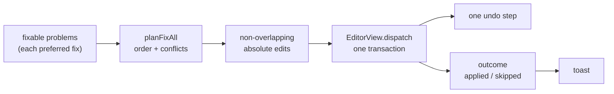

# Fix All Diagnostics

> [!NOTE]
> Status: **implemented**. The Problems panel applies every fixable problem's
> preferred fix in one edit, so a script with many repairs is corrected in a click.
> The fix producers and the per-row lightbulbs are unchanged; this note owns planning
> the batch and resolving what happens when two fixes collide.

## Table of contents

- [Goal and scope](#goal-and-scope)
- [Ubiquitous language](#ubiquitous-language)
- [Writer-facing behavior](#writer-facing-behavior)
- [Architecture](#architecture)
- [Key design decisions](#key-design-decisions)
- [Error and boundary cases](#error-and-boundary-cases)
- [Integration](#integration)
- [Testability](#testability)
- [Alternatives not chosen](#alternatives-not-chosen)
- [Out of scope](#out-of-scope)

## Goal and scope

A diagnostic may carry a fix — a titled set of text edits — and the editor offers each one
individually ([Diagnostic Quick Fixes](./Diagnostic%20Quick%20Fixes.md)). When a script carries
many of them, repairing one at a time is the only way through. `ddown compile --fix` already
applies a compile's preferred fixes in one pass; this note brings that batch to the editor.

From the Problems panel, **Fix all** applies every fixable problem's preferred fix in a single
edit that one undo reverts, and reports what it applied and what it had to skip.

**In scope:** the batch plan and its conflict policy, the panel affordance, the one-transaction
apply, and the outcome the writer sees.

**Out of scope:** the fix model, the producers, the per-row lightbulbs, and the CLI's fix mode,
all owned by their notes.

## Ubiquitous language

| Term                    | Meaning                                                                                                                 |
| ----------------------- | ----------------------------------------------------------------------------------------------------------------------- |
| **Preferred fix**       | The first of a diagnostic's fixes, the auto-applicable repair (see Quick Fixes).                                        |
| **Fixable problem**     | A diagnostic carrying at least one fix. This is the counted unit: the panel's `N` and the toast both count these.       |
| **Candidate**           | One fixable problem's preferred fix, expressed as absolute edits against the current buffer.                            |
| **Fix plan**            | The ordered, non-overlapping set of edits the batch applies.                                                            |
| **Skipped**             | A candidate the plan drops — it overlaps an applied candidate, edits nothing, or names text the buffer no longer holds. |
| **Fix all**             | The panel action that applies the plan in one edit.                                                                     |

## Writer-facing behavior

In Edit mode the Problems panel leads with a toolbar whose control is **Fix all (N)**, where
`N` counts the fixable problems. Activating it applies each preferred fix at once. With
`DLG1113`, the only fix producer today — its fix escapes the arrow — a line carrying two dangling
arrows is repaired in one edit and one undo:

```markdown
# The gate
Alice: Press => or => to continue.
```

becomes:

```markdown
# The gate
Alice: Press \=> or \=> to continue.
```

A toast states the outcome — `Fixed 2 problems.`, or `Fixed 2 problems; 1 skipped.` when a
candidate could not be applied — so a squiggle that survives the batch is explained. View mode and
the exported report show no button.

## Architecture

The plan is a pure function over the fixable problems and a position resolver; the source view
supplies the resolver, dispatches the plan, and the panel only asks for it.



| Type                | Responsibility                                                    | Change                                             |
| ------------------- | ----------------------------------------------------------------- | -------------------------------------------------- |
| `fix-all.ts`        | Turn fixable problems and a position resolver into a fix plan.    | New: the planner, a pure function.                 |
| `source-view.ts`    | Resolve each range, dispatch the plan in one transaction.         | `SourceViewHandle` gains `applyAllFixes`.          |
| `problems-panel.ts` | Offer the batch and pass the problems on.                         | A toolbar with the count, an `applyAll` option.    |
| `app.ts`            | Route the click to the handle and show the outcome.               | Wires `applyAll` and the toast.                    |
| `styles.css`        | Draw the panel toolbar and its button.                            | New `.problem-toolbar`, `.problem-fix-all`.        |

## Key design decisions

### D1 — Fix all applies each fixable problem's preferred fix

A diagnostic's fixes are alternatives, not a plan: the first is the preferred repair and the rest
are choices for the writer. The batch takes exactly the preferred one, mirroring `ddown compile
--fix`. Alternatives stay per-row, where the writer is choosing between them.

### D2 — The plan is a pure function over a position resolver

`planFixAll(diagnostics, resolve)` reads only the diagnostics and a function that maps an LSP
range to buffer offsets, so it is tested without an editor or a DOM. It returns the kept absolute
edits and the applied/skipped counts. The source view passes its own `resolveRange`, then
dispatches the returned edits in one transaction. Planning stays out of the panel, which never
learns about buffer positions, exactly as with a single fix.

### D3 — Conflicts resolve by document order; the earlier fix wins

Several fixes can touch the same text, and CodeMirror rejects an overlapping change set outright —
so a conflict must be resolved before dispatch, not left to the editor. Candidates are ordered by
their first edit's start offset, then by diagnostic code and fix title, so the compiler's emission
order never decides. A candidate whose edits overlap an already-kept one is skipped. The overlap
test is half-open, with a zero-width edit widened by one, so two insertions at one offset conflict
rather than both applying.

This is the CLI's `FixApplier` policy: the same ordering key and the same widening test. The CLI
indexes `Edits[0]` and assumes a fix always carries an edit; the planner instead skips an edit-less
fix, which is why the two are stated as the same *policy* rather than the same code. A skipped fix
is not lost — its row keeps its lightbulb until the next compile replaces the list.

### D4 — One transaction, one undo

Every edit in the plan goes into a single `userEvent: "input"` transaction, the same shape a
single fix uses. Undo reverts the whole batch in one step, the live-edit state machine sees one
dirty change, and the recompile clears the applied warnings through the normal path. Unlike a
single fix, the batch does not force `scrollIntoView`: the writer may be anywhere, so the
selection maps through the changes and the view stays put.

### D5 — Edit-only, and it reports its outcome

The button is hidden while the editor is read-only, matching the per-row lightbulbs (View mode,
the exported report), and the handle refuses a batch in a read-only editor exactly as a single fix
does. After a batch the panel toasts the counts, because a surviving squiggle after "fix all"
otherwise looks like the action failed. The label and the toast count the same unit — a problem
that carries a fix.

### D6 — The button lives in the Problems panel

The panel already lists every diagnostic and knows which carry a fix, so the count and the action
belong beside them. The label carries the count (`Fix all (3)`), and the toolbar is hidden when
nothing is fixable, so a clean panel gains no chrome. It appears even for a single fixable problem,
so the action is always where the writer looks for it rather than materializing at the second one.

## Error and boundary cases

| Case                                                        | Behavior                                                                                                                                                                        |
| ----------------------------------------------------------- | ------------------------------------------------------------------------------------------------------------------------------------------------------------------------------- |
| No diagnostic carries a fix                                 | No toolbar and no button.                                                                                                                                                       |
| One fixable problem                                         | `Fix all (1)` is offered; the action applies it like the row's lightbulb would.                                                                                                 |
| Two candidates overlap                                      | The earlier candidate is applied; the later is skipped and keeps its row until the next compile.                                                                                |
| Two insertions at one offset                                | They conflict (the zero-width edit is widened by one); the earlier wins.                                                                                                        |
| A diagnostic's range resolves to nothing (its text is gone) | Skipped, mirroring the single-fix no-op.                                                                                                                                        |
| A malformed edit (a reversed or negative offset)            | Skipped.                                                                                                                                                                        |
| A fix edits nothing (no edits)                              | Skipped.                                                                                                                                                                        |
| Several candidates at one position                          | Ordered by code, then fix title; the first is applied and its overlaps are skipped.                                                                                             |
| A multi-edit fix                                            | Applied whole and treated as one candidate for overlap.                                                                                                                         |
| The report lags the buffer (mid-debounce typing)            | Edits resolve against the current buffer; the resolver clamps, so a stale position lands on nearby text rather than being detected — the same exposure the row's lightbulb has. |
| Read-only editor or View mode                               | No button, and the handle refuses a batch (as a single fix is refused).                                                                                                         |
| Undo after a batch                                          | One step restores the buffer before the batch.                                                                                                                                  |

## Integration

- **Payload:** unchanged. The plan reads the `fixes` already projected onto each diagnostic
  ([Diagnostic Quick Fixes](./Diagnostic%20Quick%20Fixes.md#architecture)).
- **Problems panel:** `ProblemsPanelOptions` gains `applyAll(diagnostics)`; the panel computes the
  fixable count for its label and hands the list on, as it does for a single fix.
- **Source view:** `SourceViewHandle` gains `applyAllFixes(diagnostics): FixAllOutcome`, reusing
  `resolveRange` and the one-transaction apply. The batch resolves exactly like the row's lightbulb
  (the raw LSP range against the current buffer), not like the tooltip action (the lint range
  CodeMirror remaps as the writer types); the two differ only while the buffer has drifted from the
  last compile.
- **Live loop:** applying the batch dirties the buffer and inherits autosave and the recompile
  that clears the warnings, exactly as typing or a single fix does.

## Testability

- **Planner:** unit tests for ordering, the overlap skip with the earlier candidate winning, the
  insertion widening at one offset, the tie-break at one position, a reversed edit, an empty fix, a
  multi-edit fix, and no fixable problem.
- **Panel:** the button is absent with nothing fixable and while read-only, its label carries the
  count, and clicking it passes the diagnostics on without navigating.
- **Source view:** a batch dispatches one transaction with the expected edits and returns the
  applied and skipped counts; a candidate whose range is gone is skipped; a read-only editor
  applies nothing.
- **Live e2e:** a served script with several dangling arrows is repaired by one **Fix all**, and
  one undo restores it.

## Alternatives not chosen

| Alternative                                        | Why not                                                                                       |
| -------------------------------------------------- | --------------------------------------------------------------------------------------------- |
| Apply every alternative of every diagnostic        | Alternatives are a choice for the writer, not a plan; the batch would fight itself (D1).      |
| Let CodeMirror resolve the overlap by throwing     | An overlapping change set throws and nothing applies; the policy must decide the winner (D3). |
| Resolve conflicts in the panel                     | The panel holds no positions; the editor owns range resolution (D2).                          |
| A second CLI path just for the editor              | The CLI already applies preferred fixes; this reuses its policy rather than forking it (D3).  |
| Apply silently with no outcome                     | A skipped fix then looks like a failed action (D5).                                           |

## Out of scope

- General refactors, and fixes in the published reference.
- New fix producers: each is one attach call whose message must already name the remedy.
- Configuring the conflict policy, and applying alternatives in a batch.
